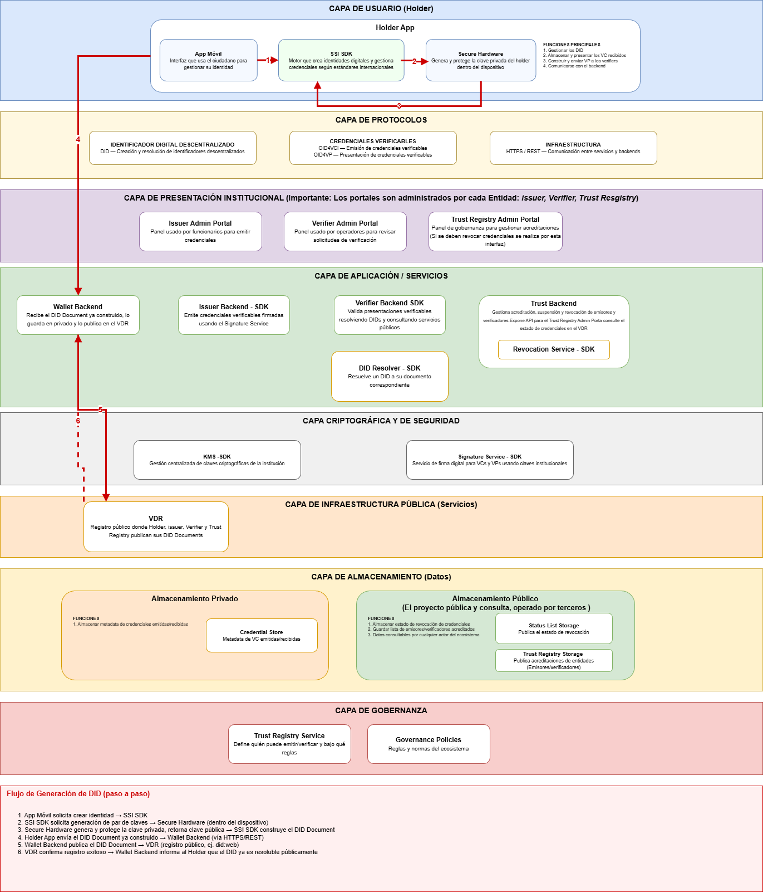
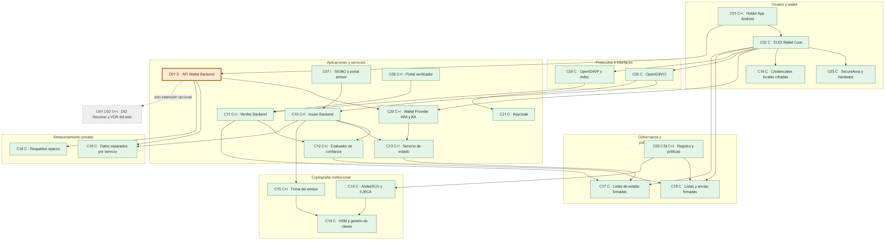
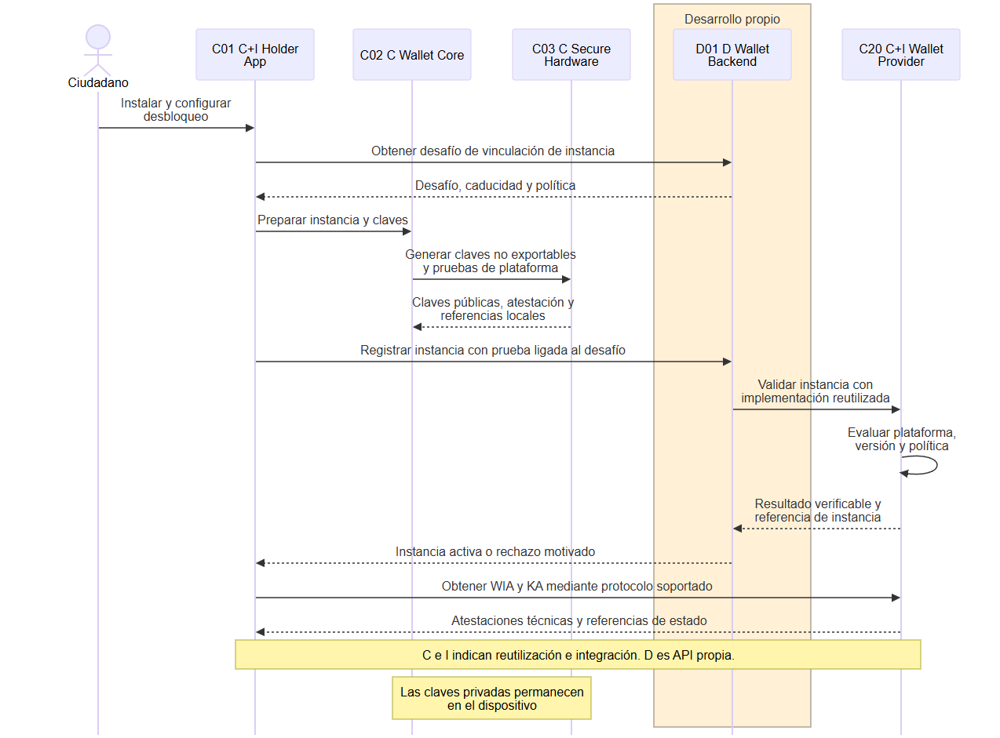
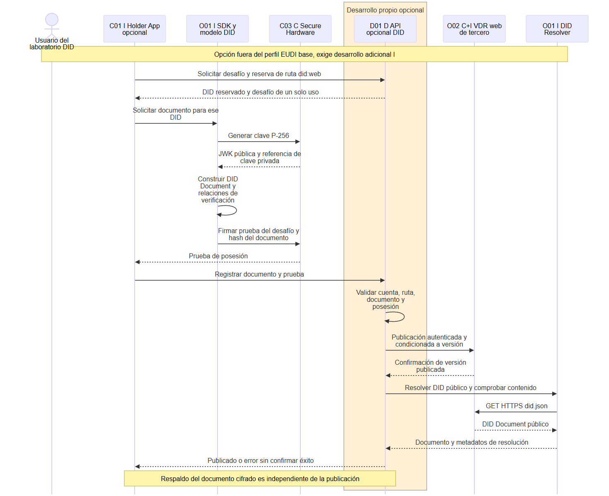
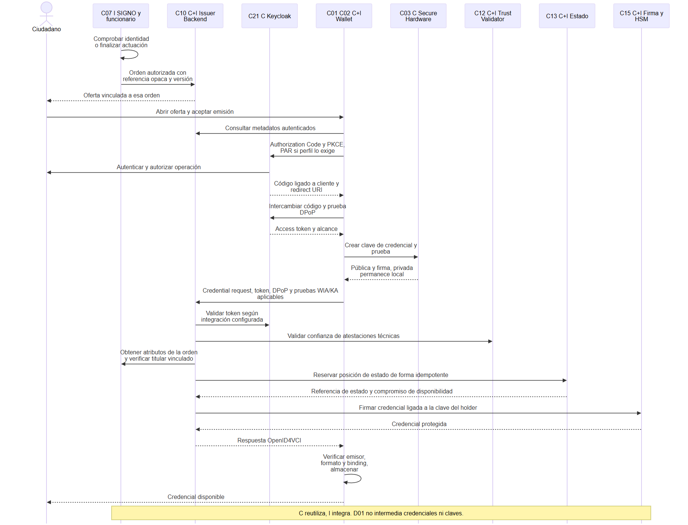
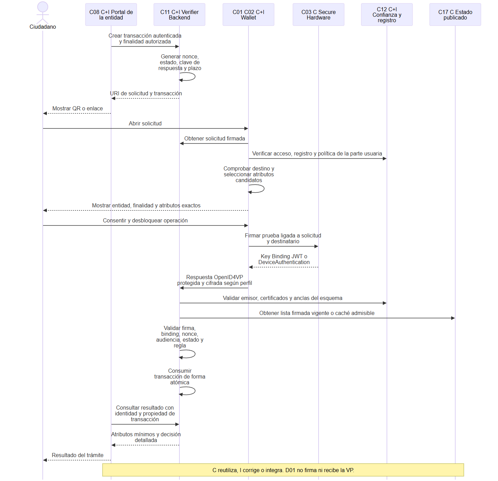
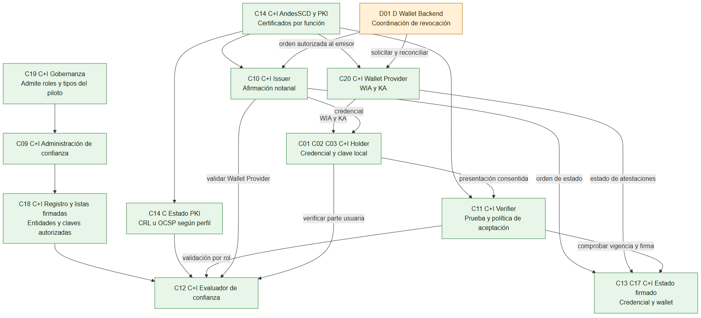
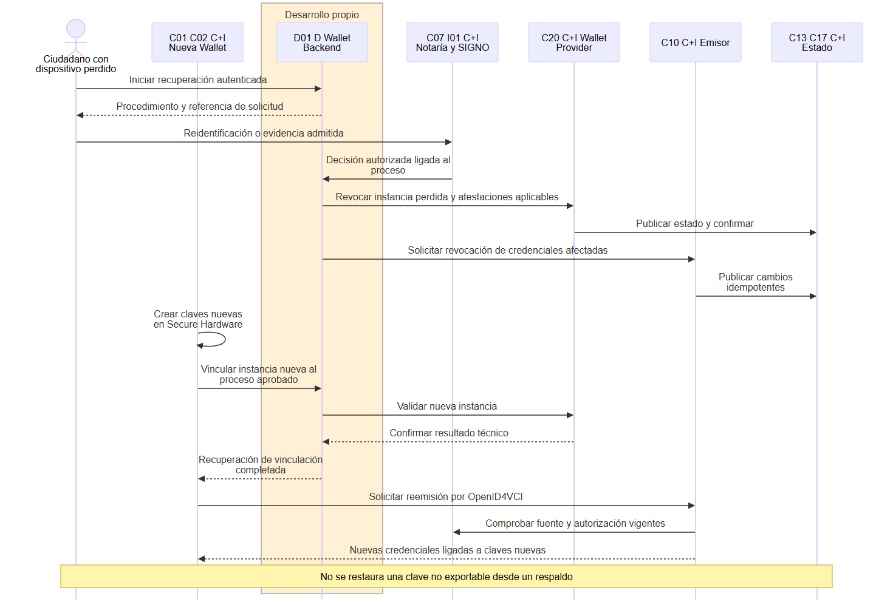
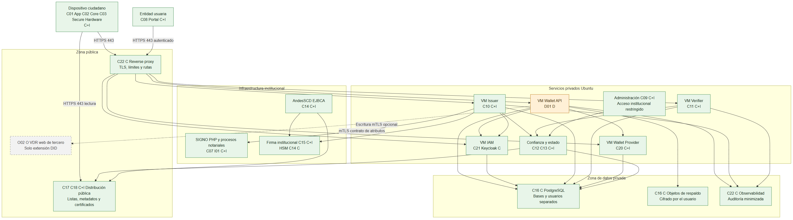

# Arquitectura de Identidad Digital Colombiana

**Versión 1.0**

**Fecha de corte 7 de septiembre de 2026**

**Documento para diseño e implementación del piloto**

El proyecto debe adoptar una arquitectura de cartera bajo control del ciudadano, emisores responsables de sus afirmaciones y verificadores que validan tanto las pruebas criptográficas como la confianza institucional. La base recomendada reutiliza la wallet Android y los servicios europeos estudiados, incorpora AndesSCD como infraestructura de certificación y utiliza SIGNO como integración con los procesos notariales. La API del Wallet Backend se construye para gestionar instancias, recuperación y servicios auxiliares; las claves del ciudadano y la generación de presentaciones permanecen en la wallet.

La decisión central es **retirar DID, DID Document y VDR (Verifiable Data Registry) del camino obligatorio del piloto alineado con EUDI**. Se conserva un diseño opcional y aislado de did:web para atender y explicar el requerimiento original. Esa extensión no es necesaria para emitir o presentar las credenciales seleccionadas y supone trabajo adicional. La ausencia de DID como requisito EUDI tampoco significa que toda biblioteca europea carezca de cualquier soporte DID: el emisor local contiene una excepción concreta, documentada en la sección 5.

Este documento define una arquitectura objetivo y contratos propuestos. No acredita que los sistemas estén desplegados, certificados o listos para producción. Las distinciones entre evidencia local, exigencia normativa, recomendación y capacidad pendiente forman parte de las decisiones de implementación.

## Índice

1.  [Objetivo, contexto y alcance](#s1)

2.  [Base normativa y perfiles de interoperabilidad](#s3)

3.  [Arquitectura y componentes](#s4)

4.  [DID y DID Document frente al modelo europeo](#s5)

5.  [Credenciales, esquemas y mecanismos criptográficos](#s6)

6.  [Emisión y presentación](#s7)

7.  [Contrato de la API del Wallet Backend](#s8)

8.  [Modelo de confianza, revocación y gobernanza](#s9)

9.  [Seguridad, recuperación y operación](#s10)

10. [Despliegue e integración institucional](#s11)

11. [Inventario de configuración frente a desarrollo](#s12)

12. [Decisiones de arquitectura](#s13)

13. [Implementación y criterios de aceptación](#s14)

14. [Fuentes, evidencia y glosario](#s15)

## 1. Objetivo, contexto y alcance

### 1.1 Propósito y destinatarios

Proporcionar al equipo de arquitectura, desarrollo, seguridad, operación y negocio una base para implementar un piloto demostrable y una ruta de evolución.

El piloto prueba que un ciudadano puede obtener una credencial derivada de una comprobación notarial, conservarla en su teléfono y presentar únicamente los atributos necesarios a una entidad participante. También debe demostrar rechazo de un emisor no confiable, rechazo por revocación y recuperación ante pérdida del dispositivo.

### 1.2 Hechos del proyecto y supuestos

| Elemento                   | Evidencia y consecuencia                                                                                                                                                                                                                                                                                                  |
|----------------------------|---------------------------------------------------------------------------------------------------------------------------------------------------------------------------------------------------------------------------------------------------------------------------------------------------------------------------|
| AndesSCD                   | El contexto del proyecto declara que el equipo opera esta autoridad de certificación y puede integrar nuevos servicios. Su base es EJBCA Community. Se reutiliza su experiencia y capacidad operativa; no se presupone la versión instalada, su configuración concreta ni disponibilidad de todos los módulos Enterprise. |
| SIGNO                      | El contexto declara instalación en el 80 % de las notarías de Bogotá y capacidad de modificar sus integraciones. El backend es PHP.                                                                                                                                                                                       |
| Acceso a fuentes estatales | El historial indica que no existe acceso directo a Registraduría. Por ello, el piloto no ofrece una cédula oficial ni afirma consultar una fuente a la que todavía no tiene acceso autorizado.                                                                                                                            |
| Ecosistema inicial         | Se propone una entidad coordinadora del piloto, AndesSCD, una o dos notarías participantes y una entidad verificadora. Los participantes exactos y su capacidad jurídica se concretan en los acuerdos del piloto.                                                                                                         |
| Tecnología                 | Experiencia fuerte en Java y servicios institucionales. Se conservan Kotlin/JVM y Android del código EUDI; no se reescriben protocolos en Java solo para uniformar el lenguaje.                                                                                                                                           |
| Despliegue                 | La preferencia previa por Ubuntu en máquinas virtuales permite usar servicios nativos y systemd. Contenedores y Kubernetes no son requisitos arquitectónicos.                                                                                                                                                             |

### 1.3 Alcance y límites

**Piloto funcional:** Android; emisión y presentación remotas; credenciales notariales con tipo colombiano propio; validación de confianza y estado; registro de entidades; API del Wallet Backend; revocación de instancias; recuperación mediante reemisión; integración controlada con SIGNO y con un verificador.

**Evolución:** proximidad mdoc, operación con varias réplicas, más emisores, integración con fuentes auténticas autorizadas, firma de documentos, certificación y reconocimiento que eventualmente correspondan. No se obtiene reconocimiento europeo por reutilizar repositorios europeos.

**Extensión opcional:** DID/W3C Data Integrity y publicación did:web. Se documenta su arquitectura y contrato, pero se excluye del camino de aceptación del piloto EUDI. Activarla exige una decisión de alcance independiente.

El término «soberana» describe aquí el control del usuario sobre sus credenciales y divulgaciones. No implica ausencia de autoridades, independencia de toda infraestructura ni que una clave autogenerada constituya identidad civil.

### 1.4 Notación

| Marca   | Significado                                                                                                                       |
|---------|-----------------------------------------------------------------------------------------------------------------------------------|
| **C**   | Componente existente o candidato reutilizable que se instala, configura o parametriza. La marca no prueba que ya esté desplegado. |
| **I**   | Integración, adaptación o corrección de código acotada fuera del Wallet Backend.                                                  |
| **D**   | Desarrollo propio de la API del Wallet Backend.                                                                                   |
| **O**   | Opción fuera del alcance base, desactivada por defecto.                                                                           |
| **EXT** | Sistema externo o autoridad cuya disponibilidad depende de acuerdos y operación ajenos al componente.                             |

Los diagramas incorporan estas marcas en las etiquetas, además de colores. Las capas son agrupaciones de responsabilidad, no una cadena obligatoria por la que deba pasar cada mensaje.

## 2. Base normativa y perfiles de interoperabilidad

### 2.1 Jerarquía y fecha de corte

La base jurídica europea es el Reglamento 910/2014, modificado por el Reglamento 2024/1183. Los reglamentos de ejecución establecen obligaciones y referencias técnicas concretas. El ARF (Architecture and Reference Framework) organiza la arquitectura y sus requisitos; un repositorio de referencia demuestra mecanismos, pero no reemplaza las obligaciones ni demuestra certificación. [Reglamento 2024/1183](https://eur-lex.europa.eu/eli/reg/2024/1183/oj).

Se toma **ARF 3.0.0**, identificado como última versión publicada en las fuentes consultadas, con fecha editorial de julio de 2026. Su publicación incorpora cambios sobre registro, obtención de anclas y evaluación funcional.

### 2.2 Reglamentos con efecto directo sobre esta arquitectura

| Norma                                                                                   | Materia                                                                                                                                                                         | Consecuencia de diseño                                                                                                  |
|-----------------------------------------------------------------------------------------|---------------------------------------------------------------------------------------------------------------------------------------------------------------------------------|-------------------------------------------------------------------------------------------------------------------------|
| [2024/2977](https://eur-lex.europa.eu/eli/reg_impl/2024/2977/oj)                        | Datos de identificación y declaraciones emitidas a wallets                                                                                                                      | Reglas de emisión, vinculación y revocación; separar datos notariales del PID europeo.                                  |
| [2024/2979](https://eur-lex.europa.eu/eli/reg_impl/2024/2979/oj)                        | Integridad y funciones básicas                                                                                                                                                  | Control del usuario, protección criptográfica, formatos y funciones de la wallet.                                       |
| [2024/2980](https://eur-lex.europa.eu/eli/reg_impl/2024/2980/oj)                        | Notificaciones del ecosistema                                                                                                                                                   | Distinguir registro local de procedimientos oficiales de notificación y publicación.                                    |
| [2024/2981](https://eur-lex.europa.eu/eli/reg_impl/2024/2981/oj)                        | Certificación de wallets                                                                                                                                                        | Riesgos, evidencias y evaluación; no basta con usar Android Keystore.                                                   |
| [2024/2982](https://eur-lex.europa.eu/eli/reg_impl/2024/2982/oj)                        | Protocolos e interfaces                                                                                                                                                         | Fijar perfiles y versiones comunes de emisión y presentación.                                                           |
| [2025/846](https://eur-lex.europa.eu/eli/reg_impl/2025/846/oj)                          | Correspondencia transfronteriza de identidad                                                                                                                                    | No usar un identificador universal público como solución automática de correspondencia.                                 |
| [2025/847](https://eur-lex.europa.eu/eli/reg_impl/2025/847/oj)                          | Reacciones a brechas de seguridad                                                                                                                                               | Revocación coordinada y procedimientos de incidente.                                                                    |
| [2025/848](https://eur-lex.europa.eu/eli/reg_impl/2025/848/oj)                          | Registro de partes usuarias                                                                                                                                                     | Registro, certificados de acceso y de registro; no confundir transparencia con autorización jurídica.                   |
| [2025/849](https://eur-lex.europa.eu/eli/reg_impl/2025/849/oj)                          | Información para la lista de wallets certificadas                                                                                                                               | El piloto no se incorpora a esa lista por autodeclaración.                                                              |
| [2025/1566](https://eur-lex.europa.eu/eli/reg_impl/2025/1566/oj)                        | Verificación de identidad y atributos para certificados y declaraciones cualificadas                                                                                            | La autenticación en Keycloak no sustituye el proceso de comprobación.                                                   |
| [2025/1569](https://eur-lex.europa.eu/eli/reg_impl/2025/1569/oj)                        | Declaraciones cualificadas y de organismos responsables de fuentes auténticas                                                                                                   | Esquemas, catálogos y verificación de fuentes; trabajo adicional para esos roles.                                       |
| [2026/798](https://eur-lex.europa.eu/legal-content/EN/TXT/PDF/?uri=CELEX%3A32026R0798)  | Incorporación remota combinando medios de nivel sustancial con procedimientos adicionales                                                                                       | Referencia para una futura alta remota de nivel alto; no atribuirlo a una captura de documento y selfie sin evaluación. |
| [2026/1730](https://eur-lex.europa.eu/legal-content/EN/TXT/PDF/?uri=CELEX%3A32026R1730) | Modifica 2025/848. Regula el registro de las entidades que solicitan datos a la cartera EUDI                                                                                    | Aplicar el registro y certificados con sus especificaciones actualizadas.                                               |
| [2026/1731](https://eur-lex.europa.eu/legal-content/EN/TXT/PDF/?uri=CELEX%3A32026R1731) | Modifica 2977, 2979, 2980 y 2982. actualiza especificaciones técnicas de la cartera EUDI, incluidos los datos de identificación, sus funciones y los protocolos de intercambio. | Actualiza estándares y anexos; no congelar el contrato técnico en los textos originales de 2024.                        |
| [2026/1735](https://eur-lex.europa.eu/legal-content/EN/TXT/?uri=CELEX%3A32026R1735)     | Modifica 2025/1569. Emisión y revocación de declaraciones electrónicas de atributos.                                                                                            | Incorporar las nuevas referencias para declaraciones y fuentes auténticas al abordar esos roles.                        |

Las modificaciones de julio de 2026 se publicaron el 22 de julio y su regla general de entrada en vigor es a los veinte días, el 11 de agosto de 2026. Existen disposiciones con aplicación diferida: por ejemplo, el artículo 1.3 de 2026/1735 se aplica desde el 1 de enero de 2027; 2026/1731 también incluye una aplicación específica desde el 11 de agosto de 2028 en el texto que sustituye de 2024/2982. La matriz de conformidad de una futura certificación debe desglosar cada obligación y fecha; «vigente» no significa que todas las obligaciones tengan el mismo calendario. [2026/1735, artículo 2](https://eur-lex.europa.eu/legal-content/EN/TXT/?uri=CELEX%3A32026R1735), [2026/1731](https://eur-lex.europa.eu/legal-content/EN/ALL/?uri=CELEX%3A32026R1731).

### 2.3 Servicios de confianza y otras normas de la recopilación

La recopilación local también contiene disposiciones sobre servicios cualificados. Se consideran para la evolución de AndesSCD, evitando convertir todas ellas en requisitos de un piloto de credenciales notariales.

| Grupo                                    | Normas de referencia                                                                                           | Aplicación al proyecto                                                                                                        |
|------------------------------------------|----------------------------------------------------------------------------------------------------------------|-------------------------------------------------------------------------------------------------------------------------------|
| Firma y sello remotos                    | 2025/1567 y 2025/1570                                                                                          | Si se incorpora gestión de dispositivos cualificados de firma/sello y su notificación.                                        |
| Supervisión y alta de servicios          | 2025/1568, 2025/1571 y 2025/1572                                                                               | Procedimientos de revisión, informes y notificación; no son endpoints del Wallet Backend.                                     |
| Tiempo y validación de firmas            | 2025/1929, 2025/1942 y 2025/1943                                                                               | Servicios de sellado de tiempo, validación y certificados cualificados, cuando se ofrezcan bajo ese marco.                    |
| Otros servicios y políticas de confianza | 2025/1944, 2025/1945, 2025/1946, 2025/2160 y 2025/2162                                                         | Revisar el instrumento concreto al incorporar el servicio correspondiente. No equivalen a una obligación general de usar DID. |
| Plantilla de listas de confianza         | [Decisión de Ejecución 2025/2164](https://eur-lex.europa.eu/eli/dec_impl/2025/2164/oj), que modifica 2015/1505 | Actualiza la versión del estándar de la plantilla común. Es una decisión, no un reglamento; afecta la integración de listas.  |
| Prestadores, archivo y libros mayores    | 2025/2527, 2025/2530, 2025/2531 y 2025/2532                                                                    | Ampliación de servicios; la regulación de libros mayores electrónicos no obliga a emplear blockchain en la wallet.            |

Fuente documental: Commission Implementing Regulations.pdf, recopilación suministrada. Esta tabla es un inventario de consideración, no un dictamen exhaustivo de aplicabilidad de todos los servicios regulados.

### 2.4 Perfiles técnicos separados

| Perfil                | Decisión                                                                | Formatos y protocolos                                                                                                                                                                                                       |
|-----------------------|-------------------------------------------------------------------------|-----------------------------------------------------------------------------------------------------------------------------------------------------------------------------------------------------------------------------|
| **CO-EUDI-PILOTO-1**  | Perfil base colombiano inspirado en EUDI; versión de proyecto propuesta | OpenID4VCI 1.0; OpenID4VP 1.0 con DCQL; SD-JWT VC dc+sd-jwt para remoto; mdoc mso_mdoc para compatibilidad y siguiente etapa de proximidad; confianza X.509 y listas; estado firmado.                                       |
| **EUDI-UE**           | Objetivo futuro de conformidad e interoperabilidad                      | Aplicar anexos jurídicos vigentes, ARF, perfiles ETSI, HAIP y requisitos por rol. Soporte simultáneo de formatos, funciones, atestaciones y evaluación que correspondan. No se declara satisfecho por el perfil colombiano. |
| **CO-W3C-OPCIONAL-1** | Extensión fuera del piloto base                                         | VC Data Model 2.0, esquema y contexto propios, mecanismo de protección W3C perfilado y Bitstring Status List 1.0; DID opcional. Exige soporte explícito en wallet, emisor y verificador.                                    |

El ARF 3.0.0 distingue mdoc y SD-JWT VC, cuyo soporte establece para las wallets, del formato W3C Data Model 2.0, opcional y orientado a declaraciones no cualificadas. **SD-JWT VC no equivale automáticamente a una credencial JSON-LD conforme a VC Data Model 2.0**, ni mdoc es un JSON con credentialSubject. [ARF, sección 5.4](https://eudi.dev/3.0.0/main/05-data-model-and-data-exchange-protocols/).

OpenID4VCI 1.0 y OpenID4VP 1.0 son especificaciones finales. «OID4VC» y «OID4VP» en los insumos se interpretan como OpenID4VCI y OpenID4VP; OpenID Connect se reserva para autenticación de cuentas. [OpenID4VCI](https://openid.net/specs/openid-4-verifiable-credential-issuance-1_0.html), [OpenID4VP](https://openid.net/specs/openid-4-verifiable-presentations-1_0.html).

Antes de integración se fijan en un manifiesto: versión/commit de cada servicio, versión efectiva del SDK móvil, perfil ETSI/HAIP, revisión de SD-JWT VC y Token Status List, revisión TS3 de atestaciones, cliente Keycloak y extensión ABCA. Si una dependencia usa un borrador, su revisión se registra; no se etiqueta como RFC final sin verificarla. Los nombres main, edge y latest no son versiones de aceptación.

### 2.5 Aplicación en Colombia

La premisa histórica «Colombia no tiene normativa de identidad digital» es demasiado amplia. Deben considerarse, al menos, la Ley 527 de 1999 sobre mensajes de datos, firmas y entidades de certificación; la Ley 1581 de 2012 sobre datos personales; y el Decreto 620 de 2020 sobre servicios ciudadanos digitales, dentro de su ámbito y modificaciones aplicables. [Ley 527](https://www.funcionpublica.gov.co/eva/gestornormativo/norma.php?i=4276), [Ley 1581](https://www1.funcionpublica.gov.co/eva/gestornormativo/norma.php?i=49981), [Decreto 620](https://www.funcionpublica.gov.co/eva/gestornormativo/norma.php?i=118337).

Se requiere una política de tratamiento y conservación por caso de uso, responsabilidades entre notaría, operador, emisor y verificador, y reglas para consultar fuentes. El consentimiento de presentación en la pantalla no subsana por sí solo falta de competencia, base jurídica o autorización para tratar datos sensibles.

AndesSCD puede operar la infraestructura técnica propuesta bajo el marco colombiano. No se presume condición de prestador cualificado europeo, reconocimiento recíproco ni que una firma de credencial sea una firma cualificada de un ciudadano. Esas condiciones se acreditan por servicio, jurisdicción y procedimiento, no mediante una elección de algoritmo.

## 3. Arquitectura y componentes

### 3.1 Propuesta de arquitectura recibida como borrador

### 3.2 Correspondencia con el grafico borrador de arquitectura original

| ID  | Bloque original                              | Decisión y responsabilidad final                                                                                                                                           |
|-----|----------------------------------------------|----------------------------------------------------------------------------------------------------------------------------------------------------------------------------|
| C01 | Holder App y App Móvil                       | Conservar app Android, consentimiento, selección y diario local. Integración I con API propia.                                                                             |
| C02 | SSI SDK                                      | Sustituir denominación por EUDI Wallet Core y bibliotecas de formatos/protocolos. El nombre SSI no implica soporte DID.                                                    |
| C03 | Secure Hardware                              | Conservar protección de claves; modelar SecureArea y su implementación real. La abstracción de software no certifica el hardware.                                          |
| C04 | Identificador Digital Descentralizado        | Retirar del perfil base. Opción O con did:web.                                                                                                                             |
| C05 | Credenciales verificables y protocolos       | Conservar OpenID4VCI/OpenID4VP; añadir perfiles de formato, metadatos, atestaciones y proximidad.                                                                          |
| C06 | Infraestructura HTTPS/REST                   | Conservar transporte, TLS, DNS y control de red; no es un mecanismo completo de confianza del emisor.                                                                      |
| C07 | Issuer Admin Portal                          | Reutilizar interfaz y procesos SIGNO para autorizar emisión; el formulario de demo no es un portal notarial terminado.                                                     |
| C08 | Verifier Admin Portal                        | Reutilizar frontend o integración institucional. La aceptación se decide en backend.                                                                                       |
| C09 | Trust Registry Admin Portal                  | Conservar gobierno de entidades; separar registro, aprobación interna del piloto y publicación de listas.                                                                  |
| D01 | Wallet Backend                               | Construir API de cuentas/instancias, respaldo opaco y recuperación. No recibe claves privadas del holder ni firma sus presentaciones.                                      |
| C10 | Issuer Backend SDK                           | Reutilizar PID Issuer como motor de emisión, adaptar tipos y fuentes para Colombia.                                                                                        |
| C11 | Verifier Backend SDK                         | Reutilizar verificador, corregir controles de confianza, estado, autorización y persistencia.                                                                              |
| O01 | DID Resolver SDK                             | Opción; DIDComponent solo aporta modelo/puertos. Resolver did:web completo requiere adaptación.                                                                            |
| C12 | Trust Backend                                | Conservar registro y evaluación de confianza; separar funciones de administración de consulta criptográfica.                                                               |
| C13 | Revocation Service SDK                       | Conservar, con servicios/formatos de estado explícitos. El dueño de cada estado autoriza su cambio.                                                                        |
| C14 | KMS SDK                                      | Conservar gestión de claves institucionales; no se convierte en almacén central de claves de ciudadanos.                                                                   |
| C15 | Signature Service SDK                        | Firma de credenciales por el emisor. Si existe firma de documentos, tendrá propósito, claves y consentimiento separados.                                                   |
| O02 | VDR                                          | Fuera del camino base; publicación web opcional. En el perfil base existen endpoints de metadatos, listas y certificados con funciones distintas.                          |
| C16 | Credential Store                             | Separar almacén completo en dispositivo, metadatos mínimos del emisor y respaldo cifrado opaco.                                                                            |
| C17 | Status List Storage                          | Publicación firmada por listas agrupadas; puede hospedarse por terceros autorizados.                                                                                       |
| C18 | Trust Registry Storage                       | Publica datos institucionales, anclas y políticas; nunca credenciales personales.                                                                                          |
| C19 | Trust Registry Service y Governance Policies | Conservar como autoridad funcional del esquema. Estar registrado no equivale a autorización legal para todo atributo.                                                      |
| C20 | Sin bloque explícito                         | Wallet Provider, atestaciones WIA/KA y gestión de estado de wallet; función requerida por el modelo EUDI, reutilizable.                                                    |
| C21 | Sin bloque explícito                         | Authorization Server/IAM, reutilizar Keycloak ya presente en el emisor local.                                                                                              |
| I01 | Integración implícita                        | Adaptador SIGNO/fuente de atributos, procedencia y vínculo con la solicitud; deriva de Issuer Backend.                                                                     |
| C22 | Infraestructura transversal implícita        | Proxy, almacenamiento, monitorización, auditoría y distribución pública. Derivan de las capas de infraestructura, datos y seguridad; no son nuevas funciones de identidad. |

La flecha original que lleva «la pública construye el DID» requiere corrección: en did:web el DID se determina por dominio y ruta, mientras la clave pública se publica en el documento. En el perfil EUDI la clave pública se vincula a la credencial o atestación sin publicar un DID ciudadano.

### 3.2 Diagrama de componentes

Los nodos C+I requieren la adaptación identificada en el inventario, aunque el motor principal sea reutilizado. El acceso a una misma infraestructura PostgreSQL no significa compartir tablas, usuarios o propiedad de datos.

### 3.3 Fronteras de responsabilidad

El holder autoriza divulgaciones y usa sus claves locales. El Wallet Provider acredita propiedades técnicas <u>de</u> la wallet, sin atribuir por ello un nombre civil a quien la instala. El emisor verifica los atributos en una fuente y firma la credencial. El verificador autentica solicitudes, valida lo presentado y aplica la regla de negocio. El registro publica información y el órgano de gobierno del piloto decide admisión y suspensión bajo sus reglas. AndesSCD emite certificados conforme al propósito definido; la CA no decide automáticamente todas las autorizaciones del negocio.

El proveedor de almacenamiento público distribuye objetos firmados. No obtiene por hospedarlos la facultad de emitir credenciales, modificar su estado o acreditar participantes. La validez se determina por la firma y la política, no por la ubicación del servidor.

## 4. DID y DID Document frente al modelo europeo

### 4.1 Qué resuelve un DID y qué no resuelve

Un DID, *Decentralized Identifier* o identificador descentralizado, identifica un sujeto mediante una sintaxis y un método. Un DID Document describe material público de verificación, relaciones de uso de claves y, opcionalmente, servicios. El método especifica cómo crear, resolver, actualizar y desactivar ese identificador. DID Core define el modelo común y las condiciones que deben cumplir los métodos; no implementa por sí solo las operaciones concretas de did:web, ION u otro método.

Resolver y dereferenciar son operaciones distintas. Resolver obtiene documento y metadatos de resolución/documento; dereferenciar una DID URL puede seleccionar una clave, servicio u otro recurso identificado por ruta, consulta o fragmento. Una biblioteca que serializa el documento no implementa necesariamente esas operaciones de red ni sus garantías.

El control de una clave prueba capacidad de usar esa clave, bajo el mecanismo correspondiente. No prueba por sí solo nombre, nacionalidad, mayoría de edad, competencia notarial o autorización como emisor. Esas afirmaciones necesitan evidencias, responsables y reglas adicionales. El DID del holder tampoco certifica que el teléfono pertenece a una persona civil determinada.

### 4.2 Qué significa que EUDI no use DID como eje arquitectónico

La conclusión tiene tres niveles:

1.  **Normativo:** eIDAS 2.0 no convierte DID ni DID Document en condición general para una cartera europea. Sus obligaciones abarcan control del usuario, identificación, atributos, seguridad, confianza e interoperabilidad.

2.  **Arquitectónico:** la infraestructura EUDI seleccionada organiza la confianza mediante entidades registradas, certificados, publicaciones de confianza, atestaciones técnicas y vinculación de claves a credenciales. No exige publicar un DID por ciudadano ni resolver un DID Document para cada presentación.

3.  **Implementación concreta:** los proyectos Android examinados no crean ni administran DID Documents. El emisor contiene una ruta auxiliar compatible con identificadores de clave DID. Por tanto, «ningún componente europeo usa nunca DID» sería una conclusión falsa.

Estas conclusiones combinan los textos jurídicos, el ARF actualizado, y las evidencias locales de 14.3. No se atribuye a la Comisión una motivación política contra DID: las razones siguientes son una **evaluación arquitectónica de este proyecto**, no una declaración histórica de intención de los autores europeos.

### 4.3 Por qué introducir DID no mejora automáticamente este piloto

**La identidad y la autorización ya necesitan instituciones.** La notaría debe responder por lo que comprobó; el operador de confianza debe identificar al emisor; el verificador debe decidir qué fuentes acepta. Un registro de claves descentralizado no elimina esas decisiones. Agregarlo como requisito introduce otra infraestructura sin sustituir el proceso notarial ni la responsabilidad jurídica.

**La prueba del holder puede viajar en la credencial.** El emisor incorpora una clave pública de confirmación o dispositivo. En la presentación, la wallet prueba posesión de la privada correspondiente sobre datos ligados a la sesión. El verificador no necesita buscar un documento público del ciudadano para descubrir esa clave.

**Un identificador público persistente facilita correlación.** Publicar por defecto un DID de cada ciudadano permite relacionar usos si reaparece en diferentes contextos. No es una propiedad inevitable de todo método DID: existen usos por pares y técnicas de privacidad. Sin embargo, el VDR público ciudadano de la imagen agrega un punto de exposición que el piloto no necesita.

**La interoperabilidad depende de perfiles concretos.** Que dos sistemas entiendan DID no garantiza que compartan formato de credencial, suite, reglas de divulgación, protocolo, estado o anclas confiables. Los repositorios ya implementan mdoc, SD-JWT y OpenID; una ruta DID/JSON-LD general requiere soporte adicional verificable.

**La recuperación no se resuelve guardando un documento público.** Si la clave vinculada a una credencial era no exportable y se perdió el dispositivo, recuperar su DID Document no recupera esa clave. La recuperación de cuenta, la recuperación de datos y la reemisión de credenciales son procedimientos diferentes.

**La dependencia operativa no desaparece.** did:web depende de DNS, HTTPS y del operador del dominio. ION añade anclajes Bitcoin, distribución de operaciones y resolución; no concede por ello autoridad para emitir atributos notariales. La arquitectura recomendada aprovecha servicios ya necesarios y evita otro camino obligatorio de disponibilidad.

### 4.4 Mecanismos que cubren las funciones atribuidas al DID

La siguiente es una correspondencia funcional para el diseño colombiano. No propone que exista un «DID Document europeo» con otro nombre: la información está distribuida entre objetos con propósitos diferentes.

| Función de la aproximación DID | Mecanismo del perfil recomendado                                                    | Qué demuestra y qué no demuestra                                                                         |
|--------------------------------|-------------------------------------------------------------------------------------|----------------------------------------------------------------------------------------------------------|
| Identificar al emisor          | Identificador HTTPS, metadatos y certificados del emisor                            | Identidad técnica; la autorización de negocio se evalúa aparte.                                          |
| Encontrar endpoints            | Metadatos OpenID del emisor/servidor de autorización y configuración verificada     | Descubrimiento; no autorización implícita para consultar URLs arbitrarias.                               |
| Encontrar clave de firma       | Cadena X.509 del objeto, claves/metadatos según perfil y anclas preestablecidas     | Permite verificar una firma; no se debe confiar automáticamente en la raíz enviada por el propio objeto. |
| Acreditar participantes        | Registro, certificados de registro, Trusted Lists o LoTE según rol                  | Participación, información registrada o condición del servicio, bajo reglas diferentes.                  |
| Clave del holder               | cnf.jwk en SD-JWT VC; deviceKeyInfo.deviceKey en el MSO de mdoc                     | Vinculación criptográfica de la credencial a una clave.                                                  |
| Prueba durante presentación    | Key Binding JWT o DeviceAuthentication, según formato                               | Posesión de clave y vínculo de sesión; no necesariamente identidad civil por sí solos.                   |
| Autenticidad de wallet         | Wallet Instance Attestation y Key Attestation, con pruebas de plataforma y política | Propiedades técnicas de instancia/claves; no sustituyen comprobación de atributos.                       |
| Autenticidad del verificador   | Certificado de acceso y solicitud autenticada; información de registro              | Quién pide datos y qué declaró pedir; no habilitación ilimitada para cualquier finalidad.                |
| Estado de claves y entidades   | Estado de certificados y publicaciones de confianza                                 | Condición del certificado/servicio; no equivale al estado de cada credencial.                            |
| Estado de credencial           | Lista de estado firmada o mecanismo perfilado de revocación/validez                 | Condición de esa credencial según frescura y política.                                                   |
| Seudónimo del usuario          | Identificador por relación o mecanismo de seudónimos del perfil                     | Reduce exposición de identificadores globales; no requiere un DID público.                               |

Los JWT/JWK, X.509, TLS, un docType, un vct, el ID de cuenta Keycloak y un identificador interno de documento son conceptos distintos. Ninguno se convierte en DID solo por ser un identificador o contener una clave.

### 4.5 WUA, WIA y KA y la excepción del emisor local

Los insumos anteriores utilizan WUA, *Wallet Unit Attestation*. En la terminología actual revisada hay que distinguir **WIA, Wallet Instance Attestation**, sobre la instancia, de **KA, Key Attestation**, sobre claves y su protección. La WIA tiene una vigencia técnica corta y la KA vincula claves a las propiedades del entorno que las protege; sus referencias de estado permiten mantener controles durante la vida de las credenciales emitidas. No deben enviarse como identificadores globales al verificador de atributos. [ARF 3.0.0, 6.5.3.4–6.5.3.5](https://eudi.dev/3.0.0/main/06-trust-model/), [especificación TS3](https://github.com/eu-digital-identity-wallet/eudi-doc-standards-and-technical-specifications/blob/main/docs/technical-specifications/ts3-wallet-unit-attestation.md).

En el emisor local, adapter/out/proof/ResolveDidUrl.kt transforma did:key o did:jwk en una JWK. VerifyKeyAttestation.kt acepta una ruta con kid y otra con x5c; la segunda consulta el evaluador de confianza. Esto es **resolución puntual de material de clave**, no generación de DID Documents del holder, ni publicación en did:web, ni integración ION.

La ruta DID sin anclaje equivalente no debe permitir eludir la confianza del Wallet Provider. Para el piloto se establece una política que acepte solo emisores de atestaciones técnicas autenticados y autorizados por las anclas del esquema. Si el código no permite imponerla mediante configuración, se registra una corrección I; no se presume que cambiar una variable cierra la ruta.

### 4.6 Activación de wallet en el perfil base

Se generan claves diferenciadas para la instancia, protección de tokens y credenciales. No se crea una «clave maestra DID» que se reutilice para todo. Una instalación vacía puede generar claves antes de recibir atributos; eso todavía no constituye una identidad comprobada.

El flujo separa la relación de cuenta con el backend de la atestación técnica. No duplica dentro de D01 la validación criptográfica de plataforma ya disponible en C20. La disponibilidad de claves protegidas debe comprobarse: ante una degradación de StrongBox a otro nivel no se declara silenciosamente la misma garantía.

### 4.7 Método y secuencia opcionales para el requerimiento DID

**Selección O:** did:web, por su encaje con alojamiento HTTPS de terceros y operación institucional conocida. Se prefiere para entidades y entornos de ensayo; se desaconseja publicar por defecto un DID permanente del ciudadano. No se selecciona ION porque el piloto no requiere su red ni el coste de operación y resolución adicional. did:key resulta útil para claves autocontenidas, pero no ofrece el mismo ciclo de actualización de un documento servido por web.

**Perfil criptográfico O:** ECDSA P-256 con SHA-256 y Data Integrity ecdsa-rdfc-2019, con método Multikey y publicKeyMultibase según esa especificación. La referencia local de DIDComponent soporta JsonWebKey2020, pero ese dato no demuestra soporte completo de esta suite. El adaptador debe convertir la clave pública del hardware a la codificación Multikey apropiada e implementar sus validaciones. JWK sigue siendo útil en la prueba JWS de registro, sin confundir esa prueba auxiliar con la protección Data Integrity de una credencial. [ECDSA Cryptosuites 1.0](https://www.w3.org/TR/vc-di-ecdsa/).

Ejemplo de resolución institucional: did:web:identidad.example.org:entidades:notaria-demo se resuelve a https://identidad.example.org/entidades/notaria-demo/did.json. En el caso de solo dominio se usa /.well-known/did.json. La clave pública no determina esa ruta. [Especificación did:web](https://w3c-ccg.github.io/did-method-web/).

El tercero recibe documentos públicos; la API de escritura es contractual, **no una API universal de did:web**. Se exige autenticación entre servicios, propiedad de rutas, control de versiones, publicación atómica y comprobación de lectura. Las credenciales personales, claves privadas y datos civiles no se incluyen en did.json.

Rotar el documento actual no ofrece por sí solo validación histórica. Si una credencial opcional referencia una clave antigua, el esquema debe conservar evidencia verificable de esa versión y de su validez, o reemitir la credencial. Eliminar una clave del documento no equivale universalmente a revocar toda firma histórica. La desactivación y su semántica quedan sujetas al método y al contrato del operador.

## 5. Credenciales, esquemas y mecanismos criptográficos

### 5.1 Catálogo inicial y procedencia

Se propone un catálogo propio; los nombres siguientes no son tipos europeos oficiales. example.org es un dominio ilustrativo reservado, no un endpoint existente. Antes de emisión real se reemplaza por un dominio controlado y se publica un rulebook versionado por tipo.

| Tipo propuesto                | Fuente y afirmación                                                                                  | Uso y minimización                                                                              |
|-------------------------------|------------------------------------------------------------------------------------------------------|-------------------------------------------------------------------------------------------------|
| IdentidadVerificadaNotarialV1 | La notaría afirma que realizó una comprobación definida en un procedimiento y fecha.                 | Identificación para el piloto. No afirma equivalencia con cédula ni con PID europeo.            |
| MayoriaEdadNotarialV1         | La notaría afirma que, al comprobar una fecha de nacimiento, la persona cumple el umbral de 18 años. | Mostrar solo el resultado booleano cuando el servicio no necesita fecha ni número de documento. |
| ActuacionNotarialV1           | La notaría afirma un hecho concreto del trámite finalizado registrado en SIGNO.                      | Acreditar la existencia de la actuación y su referencia. No transportar el expediente completo. |

Cada rulebook define emisor competente, procedimiento de comprobación, fuentes, significado de cada atributo, reglas de caducidad, motivos de revocación y aceptantes previstos. La identidad jurídica de la notaría debe permanecer identificable aunque comparta infraestructura de emisión con AndesSCD.

No convertir certificados X.509 existentes en credenciales de atributos mediante simple cambio de formato. Puede reutilizarse su evidencia dentro de un procedimiento autorizado, pero la nueva credencial es una afirmación emitida y gobernada separadamente.

### 5.2 Esquemas JSON de los sujetos

Los siguientes esquemas definen el **modelo de negocio completo propuesto para credentialSubject en la representación W3C opcional**. En SD-JWT VC se mapean a claims del payload; en mdoc se mapean a elementos del namespace. No se inserta automáticamente un objeto credentialSubject en los otros formatos.

El identificador subjectRef es opaco y específico del emisor/tipo, se oculta en presentaciones que no lo necesitan y no sustituye a la prueba de posesión. No contiene un número de cédula. La omisión deliberada de propiedades personales en una presentación selectiva no se valida contra el esquema de credencial completa: se valida contra la consulta solicitada y las pruebas de las divulgaciones.

La propiedad opcional id de estos esquemas se reserva a la representación W3C. El perfil W3C con holder binding la exige además mediante el esquema envolvente y la liga a un DID controlado por el holder. No se mapea a un identificador público en SD-JWT/mdoc: estos formatos emplean su binding criptográfico propio.

{  
"\$schema": "https://json-schema.org/draft/2020-12/schema",  
"\$id": "https://identidad.example.org/schemas/identidad-verificada-notarial/v1",  
"title": "IdentidadVerificadaNotarialV1 credentialSubject",  
"type": "object",  
"additionalProperties": false,  
"required": \["subjectRef", "givenNames", "familyNames", "verificationDate", "verificationProcedure", "notaryCode"\],  
"properties": {  
"id": {"type": "string", "format": "uri", "pattern": "^did:web:"},  
"subjectRef": {"type": "string", "minLength": 16, "maxLength": 128},  
"givenNames": {"type": "string", "minLength": 1, "maxLength": 150},  
"familyNames": {"type": "string", "minLength": 1, "maxLength": 150},  
"birthDate": {"type": "string", "format": "date"},  
"verificationDate": {"type": "string", "format": "date-time"},  
"verificationProcedure": {"const": "CO-NOTARIAL-PILOTO-1"},  
"notaryCode": {"type": "string", "pattern": "^\[A-Z0-9-\]{2,32}\$"}  
}  
}

{  
"\$schema": "https://json-schema.org/draft/2020-12/schema",  
"\$id": "https://identidad.example.org/schemas/mayoria-edad-notarial/v1",  
"title": "MayoriaEdadNotarialV1 credentialSubject",  
"type": "object",  
"additionalProperties": false,  
"required": \["ageOver18", "verificationDate", "verificationProcedure", "jurisdiction"\],  
"properties": {  
"id": {"type": "string", "format": "uri", "pattern": "^did:web:"},  
"ageOver18": {"const": true},  
"verificationDate": {"type": "string", "format": "date-time"},  
"verificationProcedure": {"const": "CO-NOTARIAL-PILOTO-1"},  
"jurisdiction": {"const": "CO"}  
}  
}

{  
"\$schema": "https://json-schema.org/draft/2020-12/schema",  
"\$id": "https://identidad.example.org/schemas/actuacion-notarial/v1",  
"title": "ActuacionNotarialV1 credentialSubject",  
"type": "object",  
"additionalProperties": false,  
"required": \["subjectRef", "actReference", "actType", "actDate", "notaryCode", "recordVersion"\],  
"properties": {  
"id": {"type": "string", "format": "uri", "pattern": "^did:web:"},  
"subjectRef": {"type": "string", "minLength": 16, "maxLength": 128},  
"actReference": {"type": "string", "minLength": 16, "maxLength": 128},  
"actType": {"enum": \["autenticacion", "declaracion_extrajuicio", "constancia_registro"\]},  
"actDate": {"type": "string", "format": "date"},  
"notaryCode": {"type": "string", "pattern": "^\[A-Z0-9-\]{2,32}\$"},  
"recordVersion": {"type": "integer", "minimum": 1}  
}  
}

El validador debe habilitar la comprobación de format; no basta con una implementación que trate date y date-time como anotaciones. Se normalizan Unicode y fechas, se impiden fechas futuras incoherentes y se verifica que la actuación esté finalizada. El backend emisor obtiene los atributos desde SIGNO mediante referencia de transacción autorizada, nunca desde un JSON que el ciudadano pueda autoafirmar como fuente notarial.

### 5.3 Mapeo a los formatos y ejemplo SD-JWT VC

| Concepto         | W3C opcional                                     | SD-JWT VC base                                | mdoc                                               |
|------------------|--------------------------------------------------|-----------------------------------------------|----------------------------------------------------|
| Tipo             | type                                             | vct                                           | docType y namespace                                |
| Emisor           | issuer                                           | iss, metadatos y certificado según perfil     | Certificado del firmante e información del esquema |
| Atributos        | credentialSubject                                | Claims y disclosures                          | Elementos con digest del namespace                 |
| Vigencia         | validFrom, validUntil                            | iat, nbf si se usa, exp                       | validityInfo del MSO                               |
| Vínculo de clave | Perfil específico de protección/presentación     | cnf.jwk                                       | Clave de dispositivo del MSO                       |
| Estado           | credentialStatus                                 | status según Token Status List/perfil         | Estructura de estado definida por perfil de mdoc   |
| Prueba           | Data Integrity u otro mecanismo W3C seleccionado | JWS del emisor y Key Binding JWT al presentar | issuerAuth COSE y DeviceAuthentication             |

Ejemplo **decodificado y esquemático**, sin firma válida ni coordenadas de clave utilizables. El objeto no debe emitirse como JSON plano ni interpretar el marcador como contenido real:

{  
"iss": "https://emisor.example.org",  
"vct": "https://identidad.example.org/types/mayoria-edad-notarial/v1",  
"iat": 1788786000,  
"exp": 1788872400,  
"\_sd_alg": "sha-256",  
"\_sd": \["DIGEST_BASE64URL_DE_LA_DIVULGACION"\],  
"cnf": {"jwk": {"kty": "EC", "crv": "P-256", "x": "COORDENADA_X", "y": "COORDENADA_Y"}},  
"status": {"status_list": {"idx": 42, "uri": "https://estado.example.org/lists/notarial-2026-09"}}  
}

El emisor prepara disclosures con sales criptográficas y sus resúmenes; firma el payload. La wallet conserva token y disclosures. Presenta el subconjunto consentido y una prueba de vinculación a su clave. El hash de la divulgación y la firma del emisor protegen la afirmación; el booleano ageOver18 es una afirmación emitida, **no una demostración de conocimiento cero de un cálculo realizado por la wallet**.

Para el piloto, la credencial de mayoría de edad puede expirar en 24 horas y renovarse mediante el procedimiento permitido. Es un parámetro de diseño propuesto que limita exposición y facilita ensayo de revocación, no una duración impuesta por eIDAS. La validez de las credenciales no puede exceder los compromisos de mantenimiento de estado aplicables a sus claves/instancia.

### 5.4 Representación W3C opcional

Ejemplo del documento de datos previo a protegerlo. El contexto de dominio y el esquema deben publicarse y fijarse por versión antes de usarlo; el ejemplo no es una credencial firmada utilizable.

{  
"@context": \["https://www.w3.org/ns/credentials/v2", "https://identidad.example.org/contexts/notarial/v1"\],  
"type": \["VerifiableCredential", "MayoriaEdadNotarialV1"\],  
"issuer": "did:web:identidad.example.org:entidades:notaria-demo",  
"validFrom": "2026-09-07T15:00:00Z",  
"validUntil": "2026-09-08T15:00:00Z",  
"credentialSubject": {  
"id": "did:web:identidad.example.org:holders:4bc9de07e1cb4d05ac965194924cd51e",  
"ageOver18": true,  
"verificationDate": "2026-09-07T15:00:00Z",  
"verificationProcedure": "CO-NOTARIAL-PILOTO-1",  
"jurisdiction": "CO"  
},  
"credentialSchema": {  
"id": "https://identidad.example.org/schemas/credentials/mayoria-edad-notarial/v1",  
"type": "JsonSchema"  
},  
"credentialStatus": {  
"id": "https://estado.example.org/w3c/notarial-2026-09#42",  
"type": "BitstringStatusListEntry",  
"statusPurpose": "revocation",  
"statusListIndex": "42",  
"statusListCredential": "https://estado.example.org/w3c/notarial-2026-09"  
}  
}

credentialSchema referencia un esquema de la credencial completa. Para el ejemplo, el esquema envolvente siguiente aplica el esquema del sujeto y exige su vínculo con el holder. Los otros dos tipos publican envolventes equivalentes, sustituyendo tipo y referencia del sujeto. Se usa validFrom/validUntil de la versión 2.0. [VC Data Model 2.0](https://www.w3.org/TR/vc-data-model-2.0/), [mecanismo W3C de JSON Schema](https://www.w3.org/TR/vc-json-schema/).

{  
"\$schema": "https://json-schema.org/draft/2020-12/schema",  
"\$id": "https://identidad.example.org/schemas/credentials/mayoria-edad-notarial/v1",  
"type": "object",  
"required": \["@context", "type", "issuer", "validFrom", "validUntil", "credentialSubject", "credentialStatus"\],  
"properties": {  
"@context": {"type": "array", "contains": {"const": "https://www.w3.org/ns/credentials/v2"}},  
"type": {"type": "array", "allOf": \[{"contains": {"const": "VerifiableCredential"}}, {"contains": {"const": "MayoriaEdadNotarialV1"}}\]},  
"issuer": {"type": "string", "format": "uri", "pattern": "^did:web:"},  
"validFrom": {"type": "string", "format": "date-time"},  
"validUntil": {"type": "string", "format": "date-time"},  
"credentialSubject": {  
"allOf": \[  
{"\$ref": "https://identidad.example.org/schemas/mayoria-edad-notarial/v1"},  
{"type": "object", "required": \["id"\]}  
\]  
},  
"credentialStatus": {"type": "object", "required": \["id", "type", "statusPurpose", "statusListIndex", "statusListCredential"\]}  
}  
}

El esquema valida estructura, no confianza, vigencia relativa o firma. El contexto JSON-LD de dominio debe definir los términos propios con semántica estable y cargarse desde una copia fijada y verificada; se bloquea resolución arbitraria durante validación.

Se selecciona DataIntegrityProof con cryptosuite=ecdsa-rdfc-2019, P-256, canonicalización RDFC y método Multikey. El emisor firma con proofPurpose=assertionMethod; la presentación del holder usa authentication, desafío y dominio/destinatario definidos por el perfil. La verificación debe enlazar el controlador de la clave de la presentación con credentialSubject.id, además de validar la firma y confianza del emisor. Firmar una VP con cualquier clave no demuestra ser el titular de una VC copiada. [Suite ECDSA de W3C](https://www.w3.org/TR/vc-di-ecdsa/).

Esta suite no permite eliminar atributos arbitrariamente de una credencial firmada y conservar su prueba. La opción usa credenciales mínimas separadas, como mayoría de edad. Incorporar ecdsa-sd-2023 u otra protección selectiva requeriría otro perfil y prueba de interoperabilidad. La publicación del DID del holder aumenta el riesgo de correlación y dependencia del dominio; incluso con identificadores aleatorios por relación, es un coste explícito del laboratorio opcional. La implementación y elección de una biblioteca compatible son trabajo I pendiente, fuera del piloto base.

### 5.5 Perfil criptográfico del piloto base

| Uso                        | Elección propuesta                                                                                              | Custodia y condiciones                                                                          |
|----------------------------|-----------------------------------------------------------------------------------------------------------------|-------------------------------------------------------------------------------------------------|
| Firma de credencial SD-JWT | ES256, P-256 y SHA-256                                                                                          | Clave de emisor en HSM; certificado y metadatos con propósito y cadena adecuados.               |
| Firma de credencial mdoc   | COSE ES256 sobre estructuras del formato                                                                        | Emisor; probar codificación COSE/CBOR y representación de firma.                                |
| Holder binding             | P-256 por credencial técnica o lote conforme a política                                                         | Secure Hardware; evitar reutilización transversal.                                              |
| Prueba OAuth DPoP          | Clave separada del holder binding                                                                               | Protección del token para emisor/audiencia concreta. DPoP no sustituye prueba de la credencial. |
| Respuesta cifrada          | Algoritmos de JWE negociados y restringidos por perfil, preferentemente ECDH-ES y AES-GCM donde sean soportados | Claves efímeras de transacción del verificador; probar con HAIP/ETSI seleccionado.              |
| Respaldo                   | JWE dir con A256GCM, clave aleatoria de 256 bits bajo control del usuario                                       | Nonce único, integridad y metadatos autenticados; nunca clave de recuperación en el backend.    |
| Transporte                 | TLS 1.3 preferido, TLS 1.2 solo con política aprobada                                                           | Certificados válidos, hostname verificado y confianza explícita.                                |

Esta selección no representa una lista exhaustiva de algoritmos admitidos por la Unión Europea. Es una intersección propuesta para el piloto que debe validarse con versiones y dispositivos elegidos. La compatibilidad de AndesSCD/HSM con ECDSA, JOSE y COSE debe comprobarse; una firma de PDF o una interfaz para certificados no demuestra esa compatibilidad.

### 5.6 Estado y presentaciones

Para SD-JWT/mdoc se utilizará el perfil de listas de estado que soporten de manera compatible el emisor, wallet, verificador y servicio seleccionado. El código local usa Statium/Token Status List; el servicio europeo de revocación publica capacidades ASL/ARL que deben contrastarse por versión. No se conectan nombres parecidos suponiendo equivalencia de formato. [Servidor europeo de revocación](https://github.com/eu-digital-identity-wallet/eudi-srv-statuslist-py).

La opción W3C emplea Bitstring Status List 1.0, diferenciando revocation y suspension. No reutiliza el token de estado EUDI como si fuese automáticamente una VC W3C de estado. [Bitstring Status List](https://www.w3.org/TR/vc-bitstring-status-list/).

En las presentaciones del perfil base, «VP» designa la respuesta verificable de protocolo. No presupone un envoltorio JSON VerifiablePresentation W3C. El verificador recibe SD-JWT con disclosures y prueba de vinculación, o una respuesta mdoc, de acuerdo con la solicitud y el formato.

## 6. Emisión y presentación

### 6.1 Emisión con fuente notarial

La unión entre orden notarial, persona autenticada y clave del dispositivo es una condición de seguridad: no basta con que el usuario conozca un número de trámite. SIGNO genera una autorización de emisión de un solo uso con titular esperado, tipo, versión de fuente, plazo y destinatario. El emisor resuelve la persona mediante el proceso acordado, consume la orden atómicamente y nunca admite que el cliente cambie el titular de la orden.

La opción de código preautorizado solo se usa si hay un procedimiento de entrega y vinculación suficientemente seguro; para credenciales de identidad se prefiere el flujo de autorización. No se incluye un secreto del emisor en el QR. Se limita la vigencia de oferta/código y se evita registrar esos valores en telemetría.

Las reservas de estado y la emisión tienen una clave idempotente. Una reserva abandonada se mantiene no reutilizable hasta expirar la ventana definida; nunca se asigna a otra credencial aún confundible con la primera. Si falla la firma, no se confirma emisión. Si falla la respuesta después de firmar, un reintento devuelve el mismo resultado o exige reemisión controlada; no crea duplicados sin registro.

### 6.2 Presentación remota

El resultado debe distinguir ACCEPTED, REJECTED e INDETERMINATE. «No pude consultar estado» no significa «no revocada». El verificador comunica razones como firma inválida, emisor no aceptado, sesión expirada, replay, atributo ausente o estado no disponible. La política de negocio decide qué acciones permite un resultado indeterminado; el piloto no permite una operación sensible con ese resultado.

El nonce procede del verificador y se comprueba en el artefacto de prueba correspondiente. state correlaciona la respuesta con la transacción; no sustituye la firma de vinculación. Se comprueba que la audiencia y el destino son los de esa transacción. El mero cifrado de un vp_token válido en otra sesión no corrige un fallo de binding.

### 6.3 Proximidad y verificación delegada

El QR de una presentación remota transporta el enlace a una solicitud; no equivale a mdoc por proximidad. En proximidad, el mecanismo ISO define engagement, transporte y transcript de sesión. El core local incluye QR/NFC y BLE para esos flujos; se verifica el soporte del lector y la política de autenticación del lector antes de declararlos disponibles.

La entidad puede contratar C11 como servicio de verificación. Debe crear la sesión dentro de ese servicio o proporcionar un contexto autenticado que este valide; no se debe exponer una API genérica que acepte cualquier VP sin conocer solicitud, nonce, audiencia y transacción. El servicio se aísla por entidad y retorna solo datos necesarios, conservando la atribución de quién solicitó y decidió el trámite.

## 7. Contrato de la API del Wallet Backend

### 7.1 Responsabilidad y límites

**D01 es desarrollo propio**, propuesto como servicio Java/Spring Boot, con PostgreSQL, migraciones versionadas y almacenamiento de objetos cifrados. El contrato de esta sección es una especificación de diseño.

D01 administra la relación de una cuenta con sus instancias, revocación y recuperación, configuración de producto y respaldo opcional cifrado. Usa C20 para la evaluación técnica de la wallet. La cuenta de D01 no es un PID, ni su identificador se introduce como identificador público del ciudadano en todas las credenciales.

El requisito original de «gestionar credenciales y emitir VP» se satisface así:

| Operación solicitada                      | Responsable efectivo              | Papel de D01                                                                                                      |
|-------------------------------------------|-----------------------------------|-------------------------------------------------------------------------------------------------------------------|
| Obtener una credencial                    | C01/C02 y C10 mediante OpenID4VCI | Opcionalmente suministrar catálogo de emisores permitidos; no firmar ni interceptar la respuesta.                 |
| Guardar y listar credenciales utilizables | C02, almacenamiento local         | Respaldo opaco optativo. No crea una base central de atributos del ciudadano.                                     |
| Eliminar una copia                        | C02; D01 si había respaldo        | Borrar objeto de respaldo no revoca la credencial ante terceros.                                                  |
| Revocar una credencial                    | Emisor competente y C13           | Puede coordinar una solicitud autenticada; nunca autodeclarar revocación sin confirmación del emisor.             |
| Crear una presentación                    | C01/C02/C03                       | No existe POST /v1/vp/sign: la clave del holder permanece en el teléfono. Puede coordinar una intención opcional. |
| Publicar un DID Document                  | Extensión O de D01 y O02          | Solo cuando se habilite el perfil DID.                                                                            |

La ruta base de presentación funciona sin una consulta a D01. Así, una caída del backend auxiliar no bloquea por diseño toda presentación de una credencial ya disponible; sí puede afectar recuperación o renovación de atestaciones si esas dependencias están indisponibles.

### 7.2 Endpoints existentes: reutilizar y proteger

Estas son rutas **observadas en el código local**, no nombres normalizados inventados. Sus cuerpos y errores se conservan conforme a la versión fijada del producto y del protocolo. No se vuelven a implementar dentro de D01.

| Servicio     | Método y ruta existente                                                                                        | Consumidor y tratamiento                                                                                                           |
|--------------|----------------------------------------------------------------------------------------------------------------|------------------------------------------------------------------------------------------------------------------------------------|
| C10 Issuer   | POST /issuer/credentialsOffer/create                                                                           | Portal emisor/SIGNO con autorización institucional; no publicación anónima.                                                        |
| C10 Issuer   | POST /wallet/credentialEndpoint                                                                                | Wallet, OpenID4VCI; token y pruebas del perfil.                                                                                    |
| C10 Issuer   | POST /wallet/deferredEndpoint                                                                                  | Wallet; solo si se habilita emisión diferida con persistencia corregida.                                                           |
| C10 Issuer   | POST /wallet/nonceEndpoint                                                                                     | Obtención del nonce conforme al protocolo; limitar abuso.                                                                          |
| C10 Issuer   | POST /wallet/notificationEndpoint                                                                              | Notificaciones del protocolo; validar autorización y referencia.                                                                   |
| C10 Issuer   | GET /.well-known/openid-credential-issuer                                                                      | Descubrimiento de formatos, configuraciones y endpoints reales.                                                                    |
| C10 Issuer   | GET /.well-known/jwt-vc-issuer, /public_keys.jwks, /type-metadata/{vct}                                        | Metadatos y claves públicas según perfil. JWKS público no sustituye validación de confianza institucional.                         |
| C10 Issuer   | GET /.well-known/oauth-protected-resource                                                                      | Metadatos del recurso protegido.                                                                                                   |
| C21 Keycloak | Endpoints anunciados por descubrimiento OIDC del realm                                                         | Autorización, token e introspección. No crear un segundo servidor OAuth dentro de D01.                                             |
| C11 Verifier | POST /ui/presentations, /ui/presentations/v2, /ui/presentations/dc-api                                         | Creación institucional de transacciones. Seleccionar una familia compatible con la wallet y protegerla por entidad.                |
| C11 Verifier | POST /ui/presentations/{transactionId}/dc-api                                                                  | Continuación DC API de la implementación local; no exponer sin control de sesión.                                                  |
| C11 Verifier | GET /ui/presentations/{transactionId}, /ui/presentations/{transactionId}/events, /ui/intended-uses             | Consulta autorizada, separación por entidad y minimización.                                                                        |
| C11 Verifier | GET y POST /wallet/request.jwt/{requestId}                                                                     | Solicitud de presentación conforme a las modalidades implementadas.                                                                |
| C11 Verifier | POST /wallet/direct_post/{requestId}                                                                           | Respuesta de la wallet. No imponerle un login propietario que rompa OpenID4VP; validar la transacción y las pruebas del protocolo. |
| C11 Verifier | GET /wallet/public-keys.json                                                                                   | Material público del servicio, según configuración.                                                                                |
| C11 Verifier | POST /utilities/validations/msoMdoc/deviceResponse, /utilities/validations/sdJwtVc, /utilities/process/sdJwtVc | Restringir a soporte autorizado o deshabilitar. La utilidad de procesamiento SD-JWT no equivale a validar una presentación.        |

El proveedor de wallet no existe como proyecto local inspeccionado. Como **candidato reutilizable**, el repositorio oficial ofrece POST /challenge y endpoints como POST /wallet-instance-attestation/platform-key-attestation/android. Su OpenAPI y el SDK deben fijarse juntos. No se presupone que el candidato incluya una API de consulta de registro idéntica a la que necesita D01: el adaptador I debe definir cómo obtiene un resultado verificable. [Repositorio del Wallet Provider](https://github.com/eu-digital-identity-wallet/eudi-srv-wallet-provider), [contrato publicado](https://github.com/eu-digital-identity-wallet/eudi-srv-wallet-provider/blob/main/openapi/openapi.json).

**Corrección necesaria:** ese candidato declara validadores de atestación simulados por defecto. Elegirlo exige activar validadores reales y demostrar el rechazo de una plataforma inválida. Instalarlo con valores de demostración no satisface la arquitectura.

### 7.3 Convenciones y seguridad de las rutas nuevas

Base ilustrativa: https://wallet-api.example.org/v1. JSON UTF-8, fechas UTC RFC 3339, identificadores UUID opacos, bytes en base64url sin relleno, números de versión enteros positivos. Se rechazan propiedades desconocidas en comandos, cadenas fuera de longitud y cuerpos mayores que su límite. Las URLs del cliente se tratan como datos no confiables.

**Autenticación:** cuenta OIDC gestionada por C21, autorización de código con PKCE en app pública, sin secreto embebido. D01 exige access token con emisor, audiencia propia, vigencia y scopes correctos; token ligado a una clave mediante DPoP en el perfil propuesto. Cada petición DPoP valida método, URL, tiempo, hash del token y jti con almacén compartido contra replay. El token ID no se usa como access token. Las claves de DPoP y de credenciales son distintas.

Para altas y recuperación, el usuario puede autenticarse desde una instalación nueva con una clave DPoP nueva. Esa autenticación da acceso a iniciar un proceso, **no autorización automática para sustituir una instancia confiable**. La finalización requiere el procedimiento de recuperación aprobado y vinculación a la nueva clave.

**Autorización:** resolver cuenta y organización desde el token validado; nunca confiar en un accountId del cuerpo. Comprobar propiedad de cada recurso. Una notaría no consulta respaldos de ciudadanos por ser emisor. Operadores usan identidades separadas y doble control para decisiones de recuperación y confianza. Entre D01 y servicios internos: mTLS y credenciales de servicio de alcance mínimo, con rotación.

**Concurrencia:** Idempotency-Key UUID obligatorio en todos los POST de negocio; misma clave, principal y hash de comando devuelve el mismo resultado durante 24 horas. Una misma clave con cuerpo distinto devuelve 409. If-Match con ETag obligatorio en sustituciones y bajas de objetos existentes; 428 si falta y 412 si cambió. En creación por PUT, exigir If-Nona-Match: \*. La idempotencia no sustituye el consumo atómico de desafíos.

**Plazos propuestos:** desafío 120 segundos; prueba de posesión con tolerancia máxima de reloj de 60 segundos; intención de presentación 5 minutos. Son parámetros del piloto, no valores normativos atribuidos a EUDI. Usar reloj sincronizado y límites distintos cuando el protocolo estándar imponga otros valores.

**Cabeceras:** Cache-Control: no-store para datos de cuenta; Location al crear; ETag en recursos versionados; Retry-After en saturación y operaciones pendientes. Listados: limit de 1 a 100, cursor opaco, {items: \[...\], nextCursor: string\|null}. Registro de auditoría con identificador de correlación generado por el servicio, sin tokens, atributos, claves ni cuerpos de respaldo.

### 7.4 Endpoints nuevos del perfil base

En los cuerpos siguientes, ? denota campo opcional en la tabla y no una sintaxis JSON. Todos requieren autenticación y propiedad salvo la configuración pública. «202» significa solicitud aceptada para proceso, nunca estado final confirmado.

| Método y ruta D01                                | Solicitud y tipos                                                                                                                   | Éxito                                             | Scope y errores específicos                                             |
|--------------------------------------------------|-------------------------------------------------------------------------------------------------------------------------------------|---------------------------------------------------|-------------------------------------------------------------------------|
| GET /v1/config                                   | Sin cuerpo; platform=android, appVersion opcionales                                                                                 | 200: Config                                       | Público, limitado; 400, 429.                                            |
| POST /v1/instance-challenges                     | {purpose: REGISTER\\REBIND, publicKeyJwk: object, recoveryId?: uuid}                                                                | 201: Challenge                                    | instances:write; 409, 422.                                              |
| POST /v1/instances                               | {challengeId: uuid, platform: ANDROID, appVersion: string, publicKeyJwk: object, platformEvidence: object, possessionProof: string} | 202: Operation; la operación termina con Instance | instances:write; 409, 410, 422, 503.                                    |
| GET /v1/instances                                | Paginación                                                                                                                          | 200: lista de Instance propias                    | instances:read.                                                         |
| GET /v1/instances/{instanceId}                   | UUID                                                                                                                                | 200: Instance, ETag                               | instances:read; 404.                                                    |
| POST /v1/instances/{instanceId}/revocations      | {reason: DEVICE_LOST\\COMPROMISED\\USER_REQUEST}; If-Match                                                                          | 202: Operation                                    | instances:revoke, autenticación reforzada; 404, 412, 428.               |
| POST /v1/recovery-requests                       | {lostInstanceId: uuid, channel: NOTARIAL_ASSISTED\\EXISTING_DEVICE}                                                                 | 202: Recovery                                     | recovery:request; 409, 429.                                             |
| GET /v1/recovery-requests/{recoveryId}           | UUID propio                                                                                                                         | 200: Recovery                                     | recovery:read; 404.                                                     |
| POST /v1/recovery-requests/{recoveryId}/complete | {newInstanceId: uuid, challengeId: uuid, possessionProof: string}                                                                   | 202: Operation                                    | recovery:complete, autorización del proceso ya aprobada; 409, 410, 422. |
| GET /v1/operations/{operationId}                 | UUID propio                                                                                                                         | 200: Operation                                    | operations:read; 404.                                                   |
| PUT /v1/backups/{backupId}                       | {formatVersion: 1, ciphertext: string}; condición ETag de creación/cambio                                                           | 201 o 200: BackupReceipt                          | backups:write; 412, 413, 422, 428.                                      |
| GET /v1/backups                                  | Paginación                                                                                                                          | 200: lista de BackupReceipt                       | backups:read.                                                           |
| GET /v1/backups/{backupId}                       | UUID propio                                                                                                                         | 200: contenido cifrado y recibo                   | backups:read; 404.                                                      |
| DELETE /v1/backups/{backupId}                    | If-Match, sin cuerpo                                                                                                                | 204, sin cuerpo                                   | backups:delete, autenticación reforzada; 404, 412, 428.                 |

Los errores comunes 400, 401, 403, 429 y 500/503 aplican según el caso a todas las rutas protegidas. Se usa 404 para recursos ajenos a fin de no revelar su existencia. Ninguna respuesta de listado contiene atributos de credenciales, número de documento, huella biométrica o claves privadas.

### 7.5 Tipos y ejemplos de instancia

| Tipo          | Campos del contrato                                                                                                                                                                                                                                                                                                                                                               |
|---------------|-----------------------------------------------------------------------------------------------------------------------------------------------------------------------------------------------------------------------------------------------------------------------------------------------------------------------------------------------------------------------------------|
| Config        | profileId: string, configVersion: integer, expiresAt: date-time, minimumAppVersion: string, issuers: array\<{issuerUrl: https-uri, credentialConfigurationIds: string\[\]}\>, walletProviderUrl: https-uri, features: object, signedConfiguration: compact-JWS. La estructura de features contiene booleanos encryptedBackup, credentialItems, presentationIntents, didExtension. |
| Challenge     | challengeId: uuid, nonce: base64url de al menos 256 bits aleatorios, purpose: enum, expiresAt: date-time, proofAudience: https-uri. El servidor conserva hash, principal, huella de clave y estado consumido.                                                                                                                                                                     |
| Instance      | instanceId: uuid, status: PENDING_VALIDATION\\ACTIVE\\SUSPENDED\\REVOCATION_PENDING\\REVOKED\\REJECTED, platform: ANDROID, keyThumbprint: string, assuranceProfile: string, createdAt: date-time, updatedAt: date-time, version: integer. La huella es privada al dominio de cuenta; no se divulga a verificadores como identificador del ciudadano.                              |
| Operation     | operationId: uuid, kind: REGISTER_INSTANCE\\REVOKE_INSTANCE\\COMPLETE_RECOVERY\\PUBLISH_DID\\UPDATE_DID\\DEACTIVATE_DID, status: PENDING\\RUNNING\\SUCCEEDED\\FAILED, resourceId?: uuid, createdAt: date-time, updatedAt: date-time, failureCode?: string.                                                                                                                        |
| Recovery      | recoveryId: uuid, lostInstanceId: uuid, status: REQUESTED\\UNDER_REVIEW\\APPROVED\\BINDING_NEW_INSTANCE\\COMPLETED\\REJECTED\\EXPIRED, expiresAt: date-time, nextAction: WAIT_REVIEW\\ATTEND_NOTARY\\USE_EXISTING_DEVICE\\REGISTER_NEW_INSTANCE\\NONE. Sin detalles de evidencia notarial en respuestas móviles.                                                                  |
| BackupReceipt | backupId: uuid, formatVersion: 1, sizeBytes: integer, ciphertextSha256: base64url, createdAt: date-time, updatedAt: date-time, version: integer. El checksum detecta cambio de transporte, no prueba por sí solo autenticidad frente a un servidor comprometido.                                                                                                                  |

signedConfiguration protege exactamente los campos de configuración canonizados por el perfil de firma. La wallet fija previamente la clave raíz de configuración o un mecanismo de actualización autorizado: no acepta que la propia respuesta le indique una nueva raíz arbitraria. La configuración de producto no reemplaza las listas de confianza del esquema.

Ejemplo de alta, con marcadores deliberados que no son tokens válidos:

{  
"challengeId": "7c5da93d-6e15-4d78-885b-826c4bb07b4b",  
"platform": "ANDROID",  
"appVersion": "1.0.0",  
"publicKeyJwk": {"kty": "EC", "crv": "P-256", "x": "PUBLIC_X", "y": "PUBLIC_Y"},  
"platformEvidence": {"type": "android-key-attestation", "certificateChain": \["CERT_DER_BASE64"\]},  
"possessionProof": "JWS_DE_LA_PRUEBA_DE_VINCULACION"  
}

El DTO platformEvidence es una unión discriminada; en la versión 1 solo admite type=android-key-attestation y certificateChain: string\[\], máximo diez certificados y 64 KiB de evidencia decodificada. La aceptación final depende de los validadores reales de C20. Si la solución requiere otra evidencia de plataforma, se añade una variante versionada; no se aceptan objetos arbitrarios como prueba suficiente.

La prueba JWS de vinculación propuesta usa ES256, typ=wallet-instance-binding+jwt, y claims aud, iat, exp, jti, challenge_id, nonce y request_hash. El hash cubre el comando completo sin possessionProof, canonizado de forma definida en el contrato; se fija JCS/RFC 8785 para evitar representaciones ambiguas. Se verifica con la clave vinculada al desafío. Es una prueba auxiliar propia, **no una WIA/KA ni un reemplazo de la autenticación OpenID**. El consumidor comprueba propósito y estado antes de consumir el desafío atómicamente.

Respuesta de aceptación HTTP 202, con Location: /v1/operations/4f9dcbaa-f12b-441b-bae2-26b464ba05f7:

{  
"operationId": "4f9dcbaa-f12b-441b-bae2-26b464ba05f7",  
"kind": "REGISTER_INSTANCE",  
"status": "PENDING",  
"createdAt": "2026-09-07T15:00:00Z",  
"updatedAt": "2026-09-07T15:00:00Z"  
}

Un alta solo concluye SUCCEEDED cuando se valida la evidencia y se persiste ACTIVE. Un timeout de C20 deja la operación pendiente/reintentable o falla; nunca activa la instancia por defecto. La prueba de plataforma debe vincularse a la clave declarada y al desafío apropiado; no basta con validar una cadena cualquiera enviada junto a otra clave.

### 7.6 Respaldo y coordinación opcionales

**Respaldo:** el cliente cifra antes de transmitir. ciphertext contiene JWE compacto con cifrado autenticado A256GCM y clave aleatoria del usuario; D01 conserva solo bytes, tamaño, versión y fechas. Límite inicial: 8 MiB por objeto, 64 MiB por cuenta, ambos configurables y sujetos a prueba. El contenido interno versionado puede incluir preferencias, DID Document opcional y credenciales cifradas, pero **nunca una exportación inexistente de claves no exportables del hardware**. Las credenciales restauradas cuyo binding se perdió se marcan no utilizables y se reemiten.

La clave de respaldo no se deriva directamente de la contraseña de inicio de sesión. La wallet genera material aleatorio y entrega al usuario un mecanismo de recuperación separado. Si se ofrece derivación a partir de una frase, se perfila una función resistente a ataques de diccionario y se audita su UX antes de activarla. Sin la clave de respaldo, D01 no puede descifrar. Una futura custodia o recuperación institucional de esa clave cambia el modelo y exige otra ADR.

Para respaldo individual de credenciales, se habilita opcionalmente esta API opaca; su implementación sigue siendo D01 y no amplía las facultades de los emisores:

| Método y ruta                        | Cuerpo / respuesta                                                                                                                | Control                                                                                      |
|--------------------------------------|-----------------------------------------------------------------------------------------------------------------------------------|----------------------------------------------------------------------------------------------|
| PUT /v1/credential-items/{itemId}    | Entrada {formatVersion: 1, ciphertext: string}; salida {itemId: uuid, sizeBytes: integer, version: integer, updatedAt: date-time} | credential-items:write, ETag; máximo 1 MiB por objeto, incluida en cuota de cuenta; 201/200. |
| GET /v1/credential-items             | Lista paginada de recibos                                                                                                         | credential-items:read; no devuelve tipo, emisor, atributos ni estado en claro.               |
| GET /v1/credential-items/{itemId}    | Objeto cifrado y recibo                                                                                                           | credential-items:read, propiedad; 200/404.                                                   |
| DELETE /v1/credential-items/{itemId} | Sin cuerpo; 204                                                                                                                   | credential-items:delete, ETag; no equivale a revocación.                                     |

El nombre, tipo, emisor, credencial y metadatos de presentación están dentro del cifrado. No se necesita habilitar a la vez respaldo completo e individual durante el piloto. Los endpoints opcionales devuelven 404 si la función está deshabilitada.

**Intención de presentación opcional:** solo si la experiencia requiere iniciar desde un portal auxiliar. La wallet sigue consultando, validando y contestando a C11 directamente.

| Método y ruta                              | Solicitud                                                      | Respuesta y control                                                                                       |
|--------------------------------------------|----------------------------------------------------------------|-----------------------------------------------------------------------------------------------------------|
| POST /v1/presentation-intents              | {authorizationRequestUri: https-uri} de máximo 4096 caracteres | 201: {intentId: uuid, status: READY_ON_DEVICE, expiresAt: date-time}; presentation-intents:write.         |
| GET /v1/presentation-intents/{intentId}    | Sin cuerpo                                                     | 200: id, URI, plazo y READY_ON_DEVICE\\EXPIRED\\CANCELLED; presentation-intents:read.                     |
| DELETE /v1/presentation-intents/{intentId} | Sin cuerpo                                                     | 204; presentation-intents:write; cancelación local, sin prometer cancelar la transacción del verificador. |

D01 valida esquema HTTPS, longitud y que el destino pertenezca al catálogo admitido, pero no descarga URLs arbitrarias ni declara validada la solicitud criptográfica. El destino final, redirects y firma se validan en la wallet. El backend tampoco registra éxito de presentación basándose en una afirmación del cliente: si el negocio necesita ese resultado, se consume el resultado autenticado de C11 por la entidad que creó la transacción. No se guardan vp_token, disclosures ni respuestas completas en estas intenciones.

### 7.7 Errores y procesamiento fiable

Errores propios: application/problem+json, con type, title, status, code, correlationId y, cuando proceda, retryable. detail explica una acción posible sin revelar datos de otras cuentas ni información criptográfica sensible. Las respuestas OpenID de los componentes existentes mantienen sus errores estándar; no se envuelven en este formato dentro del protocolo. [Problem Details, RFC 9457](https://www.rfc-editor.org/rfc/rfc9457).

| HTTP      | Códigos propios representativos                                                   | Conducta                                                  |
|-----------|-----------------------------------------------------------------------------------|-----------------------------------------------------------|
| 400       | INVALID_REQUEST, UNSUPPORTED_FIELD                                                | Corregir forma o valor de entrada.                        |
| 401       | INVALID_ACCESS_TOKEN, INVALID_DPOP                                                | Reautenticar o repetir conforme al desafío del protocolo. |
| 403       | INSUFFICIENT_SCOPE, STEP_UP_REQUIRED, POLICY_DENIED                               | No reintentar con el mismo permiso.                       |
| 404       | RESOURCE_NOT_FOUND                                                                | También recurso de otra cuenta o extensión desactivada.   |
| 409       | CHALLENGE_ALREADY_USED, IDEMPOTENCY_CONFLICT, INVALID_STATE                       | Resolver conflicto; no duplicar la acción.                |
| 410       | CHALLENGE_EXPIRED, RECOVERY_EXPIRED                                               | Iniciar un proceso nuevo autorizado.                      |
| 412 / 428 | VERSION_CONFLICT / PRECONDITION_REQUIRED                                          | Leer versión actual / enviar condición.                   |
| 413       | PAYLOAD_TOO_LARGE, BACKUP_QUOTA_EXCEEDED                                          | Reducir contenido o gestionar cuota.                      |
| 422       | INVALID_KEY, INVALID_POSSESSION_PROOF, ATTESTATION_REJECTED, DID_POLICY_VIOLATION | Rechazo semántico; no degradar controles para aceptar.    |
| 429       | RATE_LIMITED                                                                      | Respetar Retry-After.                                     |
| 502 / 503 | UPSTREAM_INVALID_RESPONSE / DEPENDENCY_UNAVAILABLE                                | Reintento acotado con la misma clave idempotente.         |
| 500       | INTERNAL_ERROR                                                                    | Correlación para soporte; sin stack trace público.        |

{  
"type": "https://wallet-api.example.org/problems/challenge-expired",  
"title": "El desafío ha expirado",  
"status": 410,  
"code": "CHALLENGE_EXPIRED",  
"correlationId": "ff8fdb91-801d-45d7-8e38-376132a5a31b",  
"retryable": false  
}

Persistir instancias, desafíos, operaciones, recibos e idempotencia con restricciones únicas y transacciones. Una tabla outbox entrega órdenes a servicios externos; un trabajador aplica reintentos con espera creciente y límite, y un reconciliador comprueba estados pendientes. No se exige Kafka para el piloto. Separar «orden emitida» de «revocación publicada». Los historiales no permiten volver de REVOKED a ACTIVE sin crear nueva instancia.

La API operativa interna de recuperación permite al personal autorizado registrar una decisión con referencias a evidencia custodiada en el sistema competente. Esa capacidad se implementa como integración administrativa I o módulo separado de D01, protegido por roles y doble control; **no existe un campo móvil approved=true**. El detalle de pantallas administrativas no queda implícitamente incluido en una simple configuración de Keycloak.

### 7.8 Extensión DID: contrato de escritura y comunicación con el VDR

Esta extensión responde al requisito de registro, publicación y respaldo, sin obligar a activar DID en el perfil base. No es un estándar OpenID ni una implementación completa disponible en DIDComponent.

| Método y ruta D01 opcional                           | Entrada                                                                              | Éxito y validación                                                                                                                                                       |
|------------------------------------------------------|--------------------------------------------------------------------------------------|--------------------------------------------------------------------------------------------------------------------------------------------------------------------------|
| POST /v1/extensions/did-challenges                   | {purpose: CREATE\\UPDATE\\DEACTIVATE, didRecordId?: uuid}                            | 201: desafío, didRecordId, DID reservado, expiresAt. El servidor asigna dominio/ruta; el cliente no elige URLs de escritura.                                             |
| POST /v1/extensions/dids                             | {didRecordId: uuid, challengeId: uuid, didDocument: object, possessionProof: string} | 202: operación PUBLISH_DID; scopes dids:write.                                                                                                                           |
| GET /v1/extensions/dids/{didRecordId}                | Sin cuerpo                                                                           | 200: {didRecordId, did, status: PENDING\\PUBLISHED\\UPDATE_PENDING\\DEACTIVATION_PENDING\\DEACTIVATED\\FAILED, version, publicDocumentUrl, lastConfirmedAt?}; dids:read. |
| PUT /v1/extensions/dids/{didRecordId}                | {challengeId, didDocument, possessionProof, newKeyProof?} y If-Match                 | 202: UPDATE_DID. Prueba con clave controladora anterior y, si rota, posesión de la nueva; dids:write.                                                                    |
| POST /v1/extensions/dids/{didRecordId}/deactivations | {challengeId, possessionProof, reason: USER_REQUEST\\COMPROMISED} y If-Match         | 202: DEACTIVATE_DID; dids:write, autenticación reforzada.                                                                                                                |

Los tipos didRecordId, challengeId son UUID; did es una cadena de hasta 512 caracteres restringida a did:web en el dominio contratado; publicDocumentUrl es HTTPS calculada por el servidor. didDocument se limita a 64 KiB y a métodos/relaciones admitidos por el perfil. Las pruebas tienen el mismo patrón de desafío de un solo uso de 8.5, con typ y audiencia específicos de la operación DID para evitar uso cruzado. Una actualización valida además que id y controladores correspondan al recurso autorizado y que ninguna clave privada aparezca en el documento.

Se admiten verificationMethod con Multikey para el perfil Data Integrity seleccionado en 6.4; las referencias authentication y assertionMethod deben resolver a claves del documento según el rol. Para un holder no se concede por defecto capacidad institucional de emitir afirmaciones. Servicios opcionales se restringen a una lista de tipos y dominios permitidos; no se publican endpoints personales ni datos civiles.

**Contrato Backend ↔ VDR, a acordar con el tercero:** PUT /managed-documents/{recordId} con DID Document, versión esperada y clave idempotente; respuesta que identifica versión, hash y URL pública. Una baja usa POST /managed-documents/{recordId}/deactivate. Estas rutas son una propuesta de adaptador, no capacidades observadas de un producto. Autenticación mTLS y token de servicio con permiso sobre un único namespace; conectividad privada o endpoint de escritura restringido. El GET público did.json permanece separado.

El adaptador confirma publicación mediante lectura desde la URL calculada y comparación del contenido/hash de la versión. Verifica TLS, tipo de contenido y tamaño, bloquea redirects fuera del dominio y direcciones internas. Mantiene estado pendiente ante timeout. Si se actualizó el tercero y falló la respuesta, la reconciliación detecta la versión ya publicada; no reescribe a ciegas.

Un registro administrativo DEACTIVATED no se presenta como prueba universal de desactivación de did:web: debe concordar con la política del método, la respuesta pública y las reglas de los resolvers que lo consumen. El historial firmado y los plazos de caché se definen en el acuerdo. Si se pierde la clave controladora, no se sustituye por conocimiento de la contraseña: se sigue una recuperación institucional auditada o se crea otro DID y se reemiten credenciales.

El respaldo del DID Document usa /v1/backups/{backupId} dentro del cifrado del usuario. El documento publicado contiene claves públicas y puede recuperarse por HTTPS; ese respaldo facilita recuperación de metadatos privados, **no recuperación de la clave privada del hardware**. El estado de una VC se consulta en su mecanismo de estado; no se inserta por defecto en el DID Document ni se equipara el VDR al servicio de revocación.

## 9. Modelo de confianza, revocación y gobernanza

### 9.1 Roles, acreditación y evaluación

La entidad coordinadora establece el rulebook del piloto y admite participantes mediante un proceso verificable. AndesSCD puede operar infraestructura y certificados; la notaría responde por la afirmación notarial; el Wallet Provider responde por la solución de wallet y sus atestaciones técnicas; la entidad verificadora decide si la evidencia satisface su trámite. Compartir infraestructura no fusiona esas responsabilidades.

| Rol                       | Evidencia de admisión y facultad                                                                                               | Límite                                                                                      |
|---------------------------|--------------------------------------------------------------------------------------------------------------------------------|---------------------------------------------------------------------------------------------|
| Emisor notarial           | Identidad de entidad, acuerdo, fuente y procedimiento aceptados, tipos permitidos, clave/certificado de firma, fechas y estado | No puede emitir cualquier atributo por tener un certificado válido.                         |
| Proveedor de wallet       | Identidad, versión y perfil de solución admitidos, material de firma WIA/KA, política de seguridad y revocación                | La WIA no acredita identidad civil del holder.                                              |
| Parte usuaria/verificador | Identidad, puntos de contacto, finalidad, tipos y atributos registrados, material de autenticación                             | Registro técnico no equivale a permiso jurídico ilimitado para pedir datos.                 |
| AndesSCD / CA             | Política de certificación, procedimientos de alta, cadenas y servicio de estado                                                | Una CA que emite TLS no se convierte automáticamente en autoridad para todos los atributos. |
| Coordinador / registro    | Procedimiento de admisión y suspensión, firmante autorizado, control de cambios                                                | No almacena credenciales ni un censo público de usuarios de wallet.                         |
| Holder                    | Clave ligada a la credencial, control local y consentimiento para la operación                                                 | Poseer una clave no prueba por sí solo los atributos civiles.                               |

El registro público incluye identificador de entidad, denominación, roles, esquemas/tipos autorizados en el piloto, endpoints institucionales, referencias de certificados/anclas, vigencia y estado. Excluye claves privadas, datos de ciudadanos y evidencias internas de evaluación. Cada versión se firma con una clave autorizada para publicar el registro, con número de secuencia y tiempo de emisión/expiración; los consumidores rechazan rollback.

Para Europa se aplican listas y certificados de los roles definidos en el ARF, incluidos mecanismos de obtención de anclas. No se debe llamar «EU Trusted List» a una lista colombiana propia. En particular, el registro de partes usuarias y sus certificados no sustituyen la valoración de la base jurídica para tratar datos; las declaraciones no cualificadas pueden tener un rulebook de confianza propio. [ARF, modelo de confianza](https://eudi.dev/3.0.0/main/06-trust-model/), [registro actualizado por 2026/1730](https://eur-lex.europa.eu/legal-content/EN/TXT/PDF/?uri=CELEX%3A32026R1730).

### 8.2 Diagrama de confianza

Las flechas al evaluador representan una responsabilidad lógica; pueden ejecutarse mediante una biblioteca local y cachés verificadas. No obligan a transmitir al servicio central cada presentación ni los atributos del usuario. Se comparte infraestructura de confianza sin convertirla en observador de todas las transacciones.

### 8.3 Cuatro dominios de estado

| Objeto                            | Quién puede cambiarlo                                         | Publicación y consecuencia                                                                                                                                             |
|-----------------------------------|---------------------------------------------------------------|------------------------------------------------------------------------------------------------------------------------------------------------------------------------|
| Credencial                        | Emisor competente, tras una orden autorizada                  | Lista de estado de credenciales. Motivos incluyen error de emisión, cambio de condición o compromiso del binding.                                                      |
| Instancia y atestaciones técnicas | Wallet Provider según sus políticas; D01 coordina solicitudes | Estado de WIA/KA según perfil, revocación de instancia y prevención de nueva emisión. La propagación a credenciales existentes exige la regla e integración previstas. |
| Certificado / clave institucional | CA y titular autorizado según política                        | CRL/OCSP u otro mecanismo exigido por el perfil; impedir nuevos usos inválidos y evaluar alcance de compromiso.                                                        |
| Acreditación de entidad           | Autoridad del esquema / coordinador                           | Actualización firmada del registro, suspensión del rol o tipo y control de fecha efectiva. No se limita a revocar una credencial individual.                           |

Suspensión y revocación tienen semánticas distintas: suspensión puede ser temporal cuando el formato y rulebook lo soporten; revocación se trata como definitiva para el objeto. No se inventa un valor de estado que las bibliotecas interpreten como «válido». En un formato que no soporte suspensión interoperable, se revoca y reemite o se define otra política explícita con todos los participantes.

El perfil base selecciona Token Status List compatible con la combinación de servicios fijada. El perfil W3C opcional usa Bitstring Status List 1.0 con statusPurpose y proof correspondientes. Son mecanismos distintos: no se transforma un índice de uno en otro sin adaptador. [Bitstring Status List 1.0](https://www.w3.org/TR/vc-bitstring-status-list/).

**Regla de validación:** comprobar integridad y autenticidad de la lista, emisor autorizado para ese objeto, algoritmo admitido, vigencia, URI y propósito, rango del índice y versión; después interpretar el estado. No basta con descargar HTTPS y leer un bit. Rechazar listas firmadas por una clave ajena aunque su formato sea correcto.

Para el piloto, publicar un cambio de estado en menos de 60 segundos y admitir caché de hasta 5 minutos es un objetivo propuesto que debe medirse. La vigencia firmada impone un límite adicional; nunca se amplía por la caché. Si falta una lista necesaria o expiró la copia admisible, resultado INDETERMINATE. La operación sensible se detiene. La proximidad completamente offline no puede garantizar conocimiento instantáneo de una revocación; su rulebook limita vigencia, antigüedad de evidencia y riesgo aceptable.

**Privacidad:** preferir listas compartidas de tamaño suficiente, cachés y distribución pública sin autenticación del ciudadano. Evitar una URL o consulta identificable por cada persona. Separar logs de publicación de logs de acceso, limitar retención y no comunicar al emisor cada sitio donde se presentó una credencial. Los índices, claves y metadatos pueden permitir correlación; divulgación selectiva no garantiza por sí sola desvinculabilidad.

### 8.4 Reglas de aceptación del verificador

El verificador acepta únicamente si se satisfacen conjuntamente: solicitud propia vigente; formato y versión permitidos; firma del emisor válida; cadena/ancla y rol aceptados; tipo dentro de facultad del emisor; vigencia temporal; estado comprobado; posesión de la clave vinculada; prueba ligada a nonce/audiencia/transcript; transacción no consumida; y atributos suficientes para la finalidad registrada.

Una presentación bien firmada de un emisor desconocido se rechaza. Un certificado vigente de una entidad suspendida no basta. Un token válido para otra sesión se rechaza. Una credencial de actuación notarial no se interpreta como certificado oficial del registro civil. Las decisiones conservan identificador de política y versión de la lista usada para poder explicar la aceptación sin guardar innecesariamente la presentación completa.

## 9. Seguridad, recuperación y operación

### 9.1 Modelo de amenazas y controles

| Amenaza                                      | Control obligatorio del diseño                                                                                           | Riesgo residual / prueba requerida                                                                                        |
|----------------------------------------------|--------------------------------------------------------------------------------------------------------------------------|---------------------------------------------------------------------------------------------------------------------------|
| Robo del teléfono o malware                  | Claves no exportables, desbloqueo local, protección de pantalla y almacenamiento, evaluación de plataforma y revocación  | El hardware no evita toda coacción o engaño al usuario. Probar dispositivo bloqueado, restauración y atestación inválida. |
| Degradación silenciosa de StrongBox          | Detectar capacidades y registrar perfil efectivo; rechazar o limitar los usos que exijan mayor nivel                     | No etiquetar TEE/software como StrongBox. Matriz real por dispositivos.                                                   |
| Emisor falso con firma correcta              | Anclas administradas, certificados por rol y tipo permitido en el registro                                               | Compromiso de raíz requiere distribución urgente de nueva política. Probar cadena autogenerada.                           |
| Lista de estado manipulada                   | Validación criptográfica real de JWT/CWT y autoridad de su firmante                                                      | Ventana de caché; probar bit alterado, firma inválida, lista expirada e índice fuera de rango.                            |
| Replay o sustitución de audiencia            | Nonce impredecible, binding, plazos y consumo atómico de transacción                                                     | Probar dos respuestas simultáneas en réplicas diferentes.                                                                 |
| Fuga entre notarías o verificadores          | Autorización por principal/entidad y propiedad de recurso; DB y scopes separados                                         | Probar acceso a un UUID ajeno incluso si se conoce.                                                                       |
| Emisión a la persona equivocada              | Unión verificable entre identidad comprobada, orden SIGNO, cuenta autorizada y clave de credencial                       | Un login correcto no corrige una orden vinculada al titular incorrecto.                                                   |
| Abuso de recuperación                        | Proceso reforzado, evidencia de reidentificación, doble control y vinculación al nuevo dispositivo                       | La recuperación es tan sensible como la primera alta. Simular toma de cuenta sin dispositivo.                             |
| SSRF mediante URL de estado, solicitud o DID | Salida de red restringida, dominios admitidos, bloqueo de redes internas, redirects controlados, límite de tamaño/tiempo | DNS rebinding: validar también destino de la conexión y usar proxy de salida controlado.                                  |
| Exfiltración por logs                        | Prohibir atributos, tokens, JWK privadas, códigos y respaldos; revisar configuración real                                | Depuración activada accidentalmente; prueba con marcadores y análisis de logs.                                            |
| Compromiso de backend                        | Privilegios mínimos, secretos externos, HSM para claves institucionales, segmentación, auditoría                         | Backend puede observar metadatos; cifrado de respaldos reduce exposición del contenido, no toda correlación.              |
| Correlación entre servicios                  | Claves por credencial/lote según perfil, minimización, no DID público del holder, no analítica cruzada                   | Algunos identificadores y listas siguen siendo correlacionables. No prometer anonimato absoluto.                          |
| Caída de dependencias                        | Cachés verificadas, estado explícito indeterminado, reintentos y reconciliación                                          | Disponibilidad tiene límites cuando se exige estado reciente. No aceptar por fallo de red.                                |
| Dependencia vulnerable o cambio de protocolo | Versiones fijadas, SBOM, revisión de avisos, pruebas de contrato y actualización controlada                              | Una etiqueta latest/edge impide reproducibilidad.                                                                         |
| Operador malicioso                           | Segregación de funciones, aprobación dual en anclas y recuperación, auditoría protegida                                  | Los superadministradores requieren control organizativo; no se resuelve solo con criptografía.                            |

### 9.2 Hallazgos del código que condicionan el piloto

Estos hallazgos se refieren a las copias locales revisadas. No constituyen afirmaciones de que todo despliegue del software europeo tenga los mismos problemas. Las referencias precisas están en 15.3.

| Hallazgo observado                                                                                                                 | Corrección exigida antes de datos reales                                                                                                                  | C / I                                               |
|------------------------------------------------------------------------------------------------------------------------------------|-----------------------------------------------------------------------------------------------------------------------------------------------------------|-----------------------------------------------------|
| Verificador: validadores de firma de Token Status List devuelven éxito sin comprobar firma, tanto JWT como CWT                     | Implementar o reutilizar verificación real y reglas de confianza del firmante. Una URL HTTPS no subsana la omisión.                                       | I, bloqueante                                       |
| Emisor: cliente Statium usa NotValidating al obtener listas                                                                        | Seleccionar verificador real; si no hay opción de configuración suficiente, adaptar código.                                                               | C+I, bloqueante                                     |
| Emisor/verificador pueden confiar de manera permisiva al faltar servicio/configuración de confianza                                | Configurar anclas/evaluador y hacer fallar el arranque de producción si faltan. Probar rechazo por rol.                                                   | C+I, bloqueante                                     |
| Emisor: rama de atestación con kid admite did:key/did:jwk como ruta distinta a certificados                                        | Deshabilitar ese camino en el perfil base o exigir la misma autorización institucional; probar que una clave autogenerada no acredita un Wallet Provider. | C si existe control suficiente; en caso contrario I |
| Verificador: APIs de creación/consulta sin una política completa de autenticación y pertenencia implementada en el propio servicio | Proteger en gateway y aplicación; guardar tenantId/principal de cada sesión.                                                                              | C+I, bloqueante                                     |
| Verificador: consulta admite omitir response_code en la condición local                                                            | No usarlo como único secreto; exigir coincidencia cuando se use y autorización del propietario siempre.                                                   | I                                                   |
| Verificador: estado de transacciones en memoria                                                                                    | Persistencia con TTL y transición atómica; antes de varias réplicas, demostrar consumo único.                                                             | I                                                   |
| Emisor: emisión diferida y controles DPoP tienen estado en memoria                                                                 | Deshabilitar diferida hasta corregirla; hacer compartido el almacenamiento de replay al escalar.                                                          | C+I                                                 |
| Fuente PID en Keycloak con acceso administrativo y datos de demostración, UUID de documento y fotografía de ejemplo                | Conector de fuente notarial y autorización de orden. Retirar fixtures de identidad; separar IAM de atributos auténticos.                                  | I, bloqueante                                       |
| Revocación consultada con programación periódica amplia; errores pueden equivaler a no revocar                                     | Rediseñar propagación observable e idempotente; no interpretar fallo como validez.                                                                        | C+I                                                 |
| Configuraciones de aprendizaje pueden no asignar estado; discrepancia /take frente a /set en integración de revocación             | Fijar API del servidor de estado y exigir referencia de estado para los tipos elegidos.                                                                   | C+I                                                 |
| Logs de desarrollo pueden contener vp_token y JWK privada efímera; perfiles admiten TLS inseguro                                   | Eliminar esos logs, usar nivel seguro y bloquear perfiles inseguros en despliegue real.                                                                   | C+I, bloqueante                                     |
| Keycloak de demostración, secretos de ejemplo, referencias edge, ausencia de migraciones operativas                                | Despliegue persistente con secretos nuevos, versión fijada, migraciones y restauración probada.                                                           | C+I                                                 |

No se copia ningún secreto encontrado en documentación o configuración. La solución no se valida repitiendo una demostración positiva: debe demostrar rechazo de las entradas adversarias de esta tabla.

### 9.3 Claves y recuperación

| Clave                                          | Custodio y uso                                                               | Recuperación                                                                                    |
|------------------------------------------------|------------------------------------------------------------------------------|-------------------------------------------------------------------------------------------------|
| Clave del holder ligada a credencial           | Secure Hardware/SecureArea del dispositivo; prueba de posesión               | Crear otra clave y reemitir; no exportar la anterior.                                           |
| Clave de instancia / autenticación auxiliar    | Wallet, con protección apropiada al perfil                                   | Revocar vinculación anterior y registrar otra mediante recuperación autorizada.                 |
| Clave DPoP                                     | App para ligar tokens de una relación API                                    | Sesión/registro nuevo; no usarla como clave universal de identidad.                             |
| Clave de respaldo                              | Usuario, separada de claves de firma                                         | Material de recuperación del usuario; si falta, se pierden esos respaldos cifrados.             |
| Firma de credenciales / WIA / KA / solicitudes | Servicio institucional correspondiente, con clave separada por rol y entorno | Procedimiento HSM, copias protegidas y rotación, bajo control institucional.                    |
| Raíces CA y registro                           | Autoridad correspondiente, con separación de funciones                       | Ceremonias, custodia y continuidad definidas; no usarlas como claves online de cada credencial. |

Una alerta de pérdida permite restringir usos inmediatamente según política, aunque la recuperación tarde más. El flujo no oculta fallos parciales: REVOCATION_PENDING persiste hasta confirmación; el soporte ve qué emisor o proveedor falta y el usuario recibe el estado real. Restaurar preferencias o documentos cifrados es independiente de recuperar facultad para firmar presentaciones.

La revocación de WIA/KA no se supone automáticamente visible en todas las credenciales ya emitidas. El emisor debe mantener las referencias y reglas necesarias, o usar la relación propia de emisión para revocar las credenciales afectadas. Una integración incompleta en este punto es un bloqueo de aceptación del caso de pérdida.

### 9.4 Operación, retención y auditoría

Se proponen objetivos iniciales para dimensionar el piloto, sujetos a medición y acuerdos: disponibilidad mensual del 99,5 % para APIs institucionales; decisión remota en menos de 3 segundos p95 excluyendo interacción humana y dependencias externas de identidad; recuperación técnica de servicio en 4 horas; pérdida máxima de metadatos operativos de 15 minutos. No son resultados obtenidos ni garantías contractuales.

Las evidencias notariales siguen en el sistema autorizado y se conservan conforme al régimen aplicable al trámite. D01 no duplica expedientes. Transacciones de presentación: eliminación del payload sensible al entregar/expirar, con objetivo máximo de 10 minutos en el piloto; conservar únicamente recibo mínimo de decisión si la finalidad lo exige. Respaldo: hasta solicitud de borrado o cierre según acuerdo. Logs operativos minimizados: propuesta inicial 30 días; auditoría de seguridad: propuesta inicial 180 días, revisada con responsables de privacidad y negocio antes de datos reales. No se atribuyen esos plazos a la legislación colombiana o europea.

Supervisar rechazos de atestación, listas expiradas, tiempos de propagación, fallos de firma, pendientes de outbox, replays, errores de autorización y cuota. Definir responsables de guardia y procedimiento de incidente para revocar claves/roles, bloquear emisión, publicar estado y comunicar según obligaciones aplicables. El número de presentaciones de una persona o sus destinos no se convierte en métrica comercial.

## 10. Despliegue e integración institucional

### 10.1 Vista de despliegue propuesta

Es una distribución lógica de destinos, no una obligación de contratar una VM por caja. Para una demostración aislada se pueden agrupar procesos compatibles con usuarios de servicio, directorios y puertos distintos. Mantener IAM, PKI/HSM y datos segregados; antes de producción dimensionar capacidad y alta disponibilidad. D01 sigue resaltado como desarrollo propio.

### 10.2 Conectividad y persistencia

| Conexión               | Política                                                                                                                                                                              |
|------------------------|---------------------------------------------------------------------------------------------------------------------------------------------------------------------------------------|
| Internet → servicios   | HTTPS 443, nombres DNS separados por función, certificados válidos y límites de cuerpo/conexión. Portales administrativos restringidos a red institucional y autenticación reforzada. |
| Proxy → procesos       | Loopback en misma VM o red privada con TLS/mTLS entre máquinas. Los puertos internos se fijan en el manifiesto de despliegue; no se abren a Internet.                                 |
| Servicios → PostgreSQL | Puerto 5432 privado, TLS, usuario por servicio y base separada; ningún usuario de aplicación administra el clúster.                                                                   |
| Emisor → SIGNO         | mTLS y credencial de servicio; solo operaciones acordadas sobre órdenes autorizadas, con límites y auditoría.                                                                         |
| Servicios → HSM        | Interfaz admitida por fabricante, por ejemplo PKCS#11; puertos de red, sesiones y mecanismos según el HSM instalado. No se inventa un puerto universal.                               |
| Publicación de listas  | Canal de escritura autenticado, promoción atómica de versión firmada; lectura pública de solo lectura, caché coherente.                                                               |
| Salida a URLs externas | Proxy/ACL de salida, destinos admitidos por rol, timeouts y límites; sin acceso a metadatos de nube ni direcciones privadas mediante URLs del cliente.                                |

PostgreSQL puede compartir infraestructura inicial entre IAM, emisor, verificador, wallet y confianza, pero conserva bases, roles, secretos y migraciones separados. El esquema issued_credential observado del emisor guarda metadatos; no se describe como repositorio completo de credenciales o evidencia notarial. La persistencia de presentación y diferida requiere adaptación explícita.

Usar systemd con usuarios sin privilegios, configuración externa, permisos restrictivos, reinicio controlado, límites de recursos y rotación de logs. Keycloak se ejecuta con base persistente y configuración de producción. Construir frontend estático con URL del backend por entorno. No usar contenedores edge, start-dev o bases H2 efímeras como despliegue real por copiar un ejemplo.

### 10.3 Integración de SIGNO y AndesSCD

**SIGNO:** publicar un adaptador I01 a partir del proceso finalizado. Contrato interno propuesto: crear una orden de emisión, consultar los atributos autorizados de una orden y consumirla con control de versión; informar corrección/anulación mediante outbox. Datos mínimos: orderId, referencia interna del titular, tipo de credencial, versión del expediente, estado del trámite, evidencia/procedimiento de comprobación, fechas, entidad emisora y vencimiento de la autorización. La referencia del titular no se expone en el QR.

El emisor no recibe permiso para consultar cualquier expediente. El adaptador verifica emisor, orden, titular esperado, finalidad y uso único. Si cambia o se anula la fuente, una orden de revocación idempotente identifica las emisiones afectadas. El transporte técnico puede ser REST/JSON desde PHP; no exige migrar SIGNO a JVM ni convertirlo en servidor OpenID completo.

**AndesSCD/EJBCA:** reutilizar enrolamiento, políticas, certificados y operación de estado donde la edición/versión instalada lo permita. La documentación actual distingue la REST de enrolamiento y un subconjunto de CA disponibles en Community de la REST de gestión completa Enterprise. Por ello, es incorrecto afirmar que Community carece de toda REST, y también es incorrecto asumir todos los endpoints de gestión. Se verifica la versión instalada antes de cerrar la integración. [EJBCA REST Interface](https://docs.keyfactor.com/ejbca/latest/ejbca-rest-interface).

C15 usa claves de firma específicas del emisor/Wallet Provider/verificador y mecanismos JOSE/COSE adecuados. EJBCA emite o administra certificados; no se presume que su endpoint de enrolamiento sea un servicio universal de firma de SD-JWT o mdoc. La clave raíz de la CA no firma cada VC ni ninguna presentación del ciudadano. Se define integración HSM compatible con la biblioteca y el formato, incluyendo conversión correcta de firmas ECDSA cuando corresponda. [Integración HSM de EJBCA](https://docs.keyfactor.com/ejbca-software/latest/hardware-security-module-hsm-integration).

Si se incorpora firma de documentos notariales, se diseña como servicio separado con consentimiento específico, política de firma, evidencia y validez legal del acto. Firmar una presentación de atributos no equivale a firmar una escritura ni a producir una firma electrónica cualificada europea.

## 11. Inventario de configuración frente a desarrollo

### 11.1 Inventario completo

La marca C significa reutilización prevista, no ausencia garantizada de trabajo. I hace visible toda modificación necesaria fuera del Wallet Backend. Los componentes nuevos en la imagen corregida se rastrean al ARF, los protocolos o a las necesidades de seguridad y operación del requisito.

| ID / componente y origen                                | Qué se reutiliza y configura                                                    | Qué se integra o construye                                                                                        | Evidencia / salida exigida                                              |
|---------------------------------------------------------|---------------------------------------------------------------------------------|-------------------------------------------------------------------------------------------------------------------|-------------------------------------------------------------------------|
| C01 Holder App — imagen                                 | App Android local; branding, entornos, catálogo, UX y permisos                  | I: cliente D01, recuperación, textos de consentimiento y presentación del perfil efectivo                         | APK reproducible y matriz de dispositivos.                              |
| C02 SSI SDK — imagen                                    | EUDI Wallet Core; gestores de documentos y transferencia, formatos y protocolos | I: adaptadores de tipo/UX que no admita configuración; no reescribir OpenID                                       | Versión compatible con app y políticas de confianza activas.            |
| C03 Secure Hardware — imagen                            | Android Keystore/SecureArea, bloqueo y capacidades del equipo                   | I si se requiere exponer/comprobar degradación; ninguna API de exportación privada                                | Pruebas de generación, firma y pérdida.                                 |
| C04 Creación/resolución DID — imagen                    | O: biblioteca DIDComponent como modelo, si se habilita opción                   | I: método, conversión Multikey, prueba, validación y cliente; no existe como función base del SDK                 | Solo aceptación del laboratorio DID.                                    |
| C05 OpenID4VCI/OpenID4VP — imagen                       | Bibliotecas existentes, discovery, DCQL, formatos y algoritmos                  | I: corregir diferencias de perfil; evitar crear protocolos propios paralelos                                      | Pruebas cruzadas con versiones fijadas.                                 |
| C06 HTTPS/REST — imagen                                 | Proxy TLS y clientes HTTP                                                       | I: políticas de salida y rutas protegidas cuando el producto no las incluya                                       | Configuración de certificados, CORS y límites.                          |
| C07 Issuer Portal — imagen                              | SIGNO como interfaz para el proceso notarial                                    | I: pantalla/acción de emisión y consulta operativa mínima                                                         | Orden ligada al expediente y al titular.                                |
| C08 Verifier Portal — imagen                            | Frontend Angular local, formularios y consultas                                 | I: autenticación institucional, ownership y presentación del resultado mínimo                                     | Trámite completo y rechazo entre entidades.                             |
| C09 Trust Portal — imagen                               | Candidato gestor de listas y controles administrativos existentes               | I: alta/baja del piloto, roles, tipos y aprobación dual si el candidato no lo ofrece                              | Flujo administrativo auditado. No hay portal local completo demostrado. |
| D01 Wallet Backend — imagen                             | Framework, IAM, DB y biblioteca criptográfica probada                           | **D: API íntegra de sección 8, persistencia, autorización, operaciones, outbox, cuotas, respaldo y recuperación** | OpenAPI de implementación, migraciones, pruebas y manual operativo.     |
| C10 Issuer Backend — imagen                             | Servicio EUDI Kotlin local; endpoints y metadatos                               | I: fuente SIGNO, tipos propios, firma HSM, estado validado, persistencia/revocación y controles de confianza      | Emisión sin atributos de demostración ni confianza permisiva.           |
| C11 Verifier Backend — imagen                           | Servicio EUDI Kotlin local; validación SD-JWT/mdoc y transacciones              | I: firma de listas, reglas de rol, autorización, persistencia atómica y corrección de logs/errores                | Casos negativos de firma, estado, replay y entidad.                     |
| O01 DID Resolver — imagen                               | O: puertos del modelo local y resolutores compatibles evaluados                 | I: resolver did:web, políticas de URL/caché/versión y pruebas; no resuelve identidad jurídica                     | Documento público válido y metadatos del método.                        |
| C12 Trust Backend — imagen                              | Candidato oficial Trust Validator y gestores de listas                          | I: registro colombiano, rulebooks, políticas y adaptación de API/versiones                                        | Rechazo de emisor/rol no admitido y de lista falsa.                     |
| C13 Revocation Service — imagen                         | Servicio de estado compatible con versión del emisor/verificador                | I: órdenes, eventos de SIGNO/Wallet Provider, reconciliación y propagación                                        | Medición de revocación, suspensión y pérdida.                           |
| C14 KMS / PKI — imagen                                  | AndesSCD, EJBCA Community, HSM instalado o compatible                           | I: integración concreta, mecanismos y separación de claves por rol                                                | Inventario de capacidades reales, políticas y ceremonia de claves.      |
| C15 Signature Service — imagen                          | Bibliotecas JOSE/COSE e interfaz HSM                                            | I: adaptador institucional si no existe firma compatible; VP firma local                                          | Vectores de prueba y rechazo de algoritmo no permitido.                 |
| O02 VDR público — imagen                                | O: HTTPS de terceros y almacenamiento público versionado                        | I: contrato de publicación, control de namespace y reconciliación                                                 | No es infraestructura necesaria del perfil EUDI base.                   |
| C16 Credential Store — imagen                           | Almacenamiento local de wallet; DB de metadatos y objetos opacos separados      | D en datos del Wallet Backend; I en repositorios persistentes de emisor/verificador                               | Esquemas, permisos, cifrado y restauración.                             |
| C17 Status List Storage — imagen                        | Publicación/caché de listas firmadas                                            | I si se requiere adaptador de formato/estado; no guardar credenciales completas                                   | Lista verificable, actualizada y sin consulta por ciudadano.            |
| C18 Trust Registry Storage — imagen                     | Almacenamiento de registros/listas y distribución firmada                       | I: esquema de roles/tipos, versión, firma y antirollback                                                          | Registro público sin datos de holders.                                  |
| C19 Governance Policies — imagen                        | Política institucional, contratos y funciones de autoridad                      | I: reglas ejecutables donde las bibliotecas no las expresen                                                       | Rulebooks aprobados y responsable de cada cambio.                       |
| C20 Wallet Provider — ARF                               | Candidato oficial reutilizable, claves, perfiles y validadores reales           | I: conexión con app/D01, instancia y estado; evaluación de capacidades del candidato                              | WIA/KA verificadas; mocks deshabilitados.                               |
| C21 IAM/Authorization Server — OpenID y código local    | Keycloak, realms, clientes, PKCE, scopes, sesiones y DB                         | I: mapeo mínimo de identidad de cuenta; no trasladar toda prueba notarial al IAM                                  | Tokens correctos por audiencia y cuenta.                                |
| I01 Fuente notarial — emisión y requisitos de atributos | SIGNO y procedimientos existentes                                               | I: contrato REST, orden de un solo uso, outbox y vínculo del titular                                              | Trazabilidad fuente → emisión → revocación.                             |
| C22 Operación y perímetro — seguridad/despliegue        | Proxy, systemd, secretos, backups, métricas y logs                              | I: manifiestos, alertas y controles que no existan                                                                | Recuperación técnica y ausencia de secretos en logs.                    |

### 11.2 Candidatos externos y compatibilidad

Además de los cuatro proyectos locales, se proponen evaluar componentes oficiales reutilizables. Esta lista no afirma que hayan sido instalados ni auditados íntegramente en esta tarea.

| Candidato                                                                                                      | Uso                                             | Verificación previa                                                                            |
|----------------------------------------------------------------------------------------------------------------|-------------------------------------------------|------------------------------------------------------------------------------------------------|
| [Wallet Provider](https://github.com/eu-digital-identity-wallet/eudi-srv-wallet-provider)                      | Atestaciones técnicas de wallet y claves        | Validadores reales de plataforma, estado y compatibilidad del SDK; desactivar simulación.      |
| [Trust Validator](https://github.com/eu-digital-identity-wallet/eudi-srv-trust-validator)                      | Evaluar cadenas/anclas y políticas de confianza | Contrato y perfiles soportados; tratamiento de errores y roles del piloto.                     |
| [Web Trusted List Manager](https://github.com/eu-digital-identity-wallet/eudi-srv-web-trustedlist-manager-py/) | Gestión/publicación de listas                   | Modelo requerido por ARF 3, firma y control administrativo; adaptación al rulebook colombiano. |
| [Status List Server](https://github.com/eu-digital-identity-wallet/eudi-srv-statuslist-py)                     | Estado de atestaciones                          | Diferenciar API ASL/ARL actual de /token_status_list/take y /set usados por versiones locales. |

El catálogo de referencia facilita ubicar componentes, pero no garantiza compatibilidad de ramas main entre sí. Una actualización del emisor puede cambiar pruebas, metadatos o formato y exigir actualizar app y verificador en conjunto. [Repositorios de referencia EUDI](https://docs.eudi.dev/latest/reference-implementation/repositories-list/).

### 11.3 Desglose del Wallet Backend

| Paquete D01        | Implementación propia                                                                                | Dependencia reutilizada                                      |
|--------------------|------------------------------------------------------------------------------------------------------|--------------------------------------------------------------|
| API y acceso       | DTO, validación, recursos, ownership, idempotencia y errores                                         | Spring Boot, validación JSON, seguridad OAuth/DPoP evaluada. |
| Ciclo de instancia | Desafíos, vinculación, estados, evidencia mínima y adaptador de evaluación                           | C20 y bibliotecas criptográficas.                            |
| Recuperación       | Expediente mínimo de proceso, decisiones autorizadas, nueva vinculación y coordinación de revocación | IAM, SIGNO y Wallet Provider.                                |
| Respaldo           | Recibos, cuotas, ETag, borrado y autorización                                                        | Object storage; cifrado ejecutado por la wallet.             |
| Fiabilidad         | DB, outbox, reintentos, reconciliación, deduplicación y auditoría                                    | PostgreSQL y planificador de trabajos.                       |
| Extensiones        | Ítems cifrados, intenciones y DID solo si se activan                                                 | Los protocolos base permanecen en servicios reutilizados.    |

No se puede estimar de forma responsable que «todo lo demás es configuración»: los defectos observados, la integración con la fuente y el perfil de credenciales requieren I. La planificación debe asignar tiempo a esas adaptaciones y su validación. Este documento identifica el trabajo; no inventa una estimación de esfuerzo sin revisión del equipo y de la infraestructura real.

## 11. Decisiones de arquitectura

Estado de las ADR: **propuestas para implementación del piloto**, salvo restricciones expresas ya fijadas por el requerimiento. La decisión de producir este documento no acredita aprobación organizativa de contratos, niveles de garantía o certificación.

| ADR    | Decisión y fundamento                                                                       | Alternativas consideradas                                               | Efecto y coste                                                                                     |
|--------|---------------------------------------------------------------------------------------------|-------------------------------------------------------------------------|----------------------------------------------------------------------------------------------------|
| ADR-01 | Perfil base sin DID/VDR: coincide con mecanismos EUDI y evita directorio público de holders | DID obligatorio con did:web o ION                                       | Retirar dependencia de C04/O01/O02; conservar laboratorio opcional.                                |
| ADR-02 | SD-JWT VC remoto y mdoc en combinación compatible; W3C como perfil separado                 | Forzar todas las credenciales a JSON-LD                                 | Reutiliza C02/C10/C11; exige rulebooks y mapeos por formato.                                       |
| ADR-03 | Claves del holder no exportables y presentación local                                       | Backend firma VP por el ciudadano; respaldo de privadas                 | Preserva control y binding; recuperación requiere reemisión.                                       |
| ADR-04 | Claves institucionales distintas por rol, en HSM cuando corresponda                         | Usar clave raíz CA o una sola clave compartida                          | C14/C15 requieren integración y políticas; limita alcance de compromiso.                           |
| ADR-05 | Confianza mediante registro, certificados, listas y reglas de rol                           | Aceptar cualquier firma válida o DID resoluble                          | C12/C18/C19 deben comprobar competencia, vigencia y estado.                                        |
| ADR-06 | WIA/KA emitidas por Wallet Provider reutilizado y validado                                  | Construir atestación de plataforma dentro de D01 o ignorarla            | Añade C20 y adaptadores I; reduce código criptográfico propio.                                     |
| ADR-07 | D01 auxiliar con API explícita y respaldo opaco opcional                                    | Backend custodial de todas las claves/credenciales                      | Desarrollo propio requerido, menor exposición de datos, recuperación más exigente.                 |
| ADR-08 | SIGNO fuente del procedimiento; IAM separado                                                | Usar atributos administrativos de Keycloak como prueba civil            | I01 y cambios C10; evita datos simulados y permisos excesivos.                                     |
| ADR-09 | Estado firmado con fallo explícito e indeterminado                                          | Aceptar si falla consulta o desactivar revocación                       | Correcciones I bloqueantes y dependencia de información reciente.                                  |
| ADR-10 | PostgreSQL y transacciones/outbox para sesiones y órdenes                                   | Memoria local en varias réplicas; bus distribuido obligatorio           | Adaptación acotada, persistencia y consumo único; no exige un broker en piloto.                    |
| ADR-11 | Ubuntu nativo con separación de procesos y zonas                                            | Kubernetes o contenedores obligatorios                                  | Aprovecha preferencia operativa; exige manifiestos y disciplina de actualización.                  |
| ADR-12 | Catálogo notarial propio, sin denominarlo PID oficial                                       | Reetiquetar mDL/PID de demo o afirmar equivalencia jurídica             | Cambiar metadatos, atributos y textos; mantiene límites de la fuente.                              |
| ADR-13 | did:web con ecdsa-rdfc-2019/Multikey solo en O                                              | ION; did:key como identidad permanente actualizable                     | Menor infraestructura nueva, pero dependencia HTTPS, privacidad e historia de claves; I adicional. |
| ADR-14 | Reutilizar código europeo fijando versiones y corrigiendo defectos                          | Reescribir en Java o desplegar demos intactas                           | Mantener Kotlin/JVM; cambios puntuales y pruebas interoperables.                                   |
| ADR-15 | Presentación basada en finalidad y atributos mínimos                                        | Pedir siempre documento completo o dato de identidad                    | Ajustes C01/C08/C11; minimización y políticas por caso.                                            |
| ADR-16 | Recuperación con reidentificación y nuevas claves                                           | Recuperación mediante solo contraseña/correo o exportar Secure Hardware | Integra D01/I01/C20/C10; reduce toma de cuenta, aumenta carga operativa.                           |

Revisar una ADR cuando cambie el marco aplicable, aparezca una fuente estatal autorizada, se incorpore iOS/proximidad, varíe la suite de protección o se habilite custodia institucional. Registrar versión, responsable, motivo, riesgos y componentes afectados; no modificar silenciosamente el perfil técnico de una credencial ya emitida.

## 13. Implementación y criterios de aceptación

### 13.1 Secuencia de implementación

| Etapa                                | Entrega concreta                                                                                                  | Criterio de salida                                                                                  |
|--------------------------------------|-------------------------------------------------------------------------------------------------------------------|-----------------------------------------------------------------------------------------------------|
| 0\. Línea base reproducible          | Versiones de repositorios y dependencias, copia del perfil, capacidades Android/HSM/EJBCA y mapa de configuración | La combinación se construye y levanta de forma repetible con datos sintéticos.                      |
| 1\. Cierre de controles de confianza | Validación de estado, anclas/roles, API protegida, datos de demo retirados, logs y TLS seguros                    | Rechazo demostrado de listas falsas, emisores ajenos y acceso entre entidades.                      |
| 2\. Emisión notarial                 | Rulebook, esquemas, I01 y firma institucional; alta técnica de wallet                                             | Credencial emitida a la clave/persona correctas desde una orden autorizada.                         |
| 3\. Presentación útil                | Portal de parte usuaria, DCQL y consentimiento, validación completa                                               | Acreditar mayoría de edad sin revelar fecha de nacimiento ni cédula.                                |
| 4\. D01 y pérdida                    | API de instancias, revocación, operaciones y recuperación; respaldo si se activa                                  | Pérdida y reemisión con claves nuevas, estados confirmados y fallos parciales visibles.             |
| 5\. Operación piloto                 | Restauración, métricas, runbooks, contratos de participantes y tratamiento de datos                               | Responsables y evidencias aprobados; objetivos medidos bajo carga acordada.                         |
| 6\. Evolución                        | Proximidad, más fuentes, alta disponibilidad o evaluación europea                                                 | Matriz de conformidad por rol y versión; sin trasladar éxito del piloto a certificación automática. |

El laboratorio DID tiene una rama de aceptación independiente; no retrasa por dependencia técnica la emisión/presentación del perfil base. No se emiten dos variantes incompatibles bajo el mismo identificador de tipo o perfil.

### 13.2 Pruebas de aceptación funcional y adversaria

Estas pruebas son **trabajo de implementación requerido**, no pruebas ejecutadas durante la redacción.

| Caso                                                             | Resultado requerido                                                                                                                    |
|------------------------------------------------------------------|----------------------------------------------------------------------------------------------------------------------------------------|
| AC-01 Alta técnica con desafío válido                            | Instancia activa solo tras validar plataforma, clave y vínculo; desafío consumido una vez.                                             |
| AC-02 Evidencia copiada de otra clave / plataforma inválida      | Rechazo; no activar por timeout ni por validador simulado.                                                                             |
| AC-03 Emisión desde orden SIGNO válida                           | Tipo/atributos exactos de fuente, clave correcta, estado y vigencia presentes.                                                         |
| AC-04 Cambio de titular o reutilización de orden                 | Rechazo atómico; un reintento legítimo conserva idempotencia.                                                                          |
| AC-05 Solicitud de mayoría de edad                               | Solo atributos necesarios, identidad/finalidad de entidad visible, sin fecha de nacimiento.                                            |
| AC-06 Firma o digest alterado                                    | Rechazo criptográfico, incluso con estructura JSON válida.                                                                             |
| AC-07 Emisor con certificado válido pero rol/tipo no admitido    | Rechazo por confianza o política.                                                                                                      |
| AC-08 Firma inválida de lista JWT y CWT                          | Rechazo/indeterminado; nunca aceptación porque la descarga HTTPS tuvo éxito.                                                           |
| AC-09 Revocación y suspensión                                    | Propagación y decisión dentro del objetivo; suspensión solo con semántica admitida.                                                    |
| AC-10 Lista expirada/no disponible                               | Usar únicamente caché admisible; fuera de ella, indeterminado y bloqueo del trámite sensible.                                          |
| AC-11 VP para otra audiencia, nonce o transacción                | Rechazo, aunque firma del emisor y cifrado sean correctos.                                                                             |
| AC-12 Dos respuestas concurrentes a la misma transacción         | Solo una transición aceptada, incluso con varias réplicas/reinicio.                                                                    |
| AC-13 UUID ajeno, response_code omitido y usuario de otro tenant | Ninguna consulta de datos o resultado ajeno.                                                                                           |
| AC-14 Atestación de clave con kid=did:key/… ajeno al perfil      | Rechazo o validación institucional equivalente; sin atajo de confianza.                                                                |
| AC-15 URLs maliciosas y redirects a red interna                  | No se realiza conexión a destino prohibido; control de tamaño/tiempo.                                                                  |
| AC-16 Pérdida del dispositivo                                    | Revocación coordinada, nueva clave y reemisión; credencial antigua no presentada desde respaldo.                                       |
| AC-17 Cuenta comprometida que solicita recuperación              | No sustituye instancia sin evidencia/procedimiento reforzado.                                                                          |
| AC-18 Respaldo leído por backend o por otra cuenta               | Backend no tiene clave de descifrado; cuenta ajena no accede; cambio de bytes detectado por autenticación del cifrado.                 |
| AC-19 Reinicio durante firma/publicación/respuesta               | No duplicar emisión ni perder órdenes; reconciliar pendientes.                                                                         |
| AC-20 Registro manipulado o versión anterior                     | Rechazo por firma, autoridad, vigencia o rollback.                                                                                     |
| AC-21 Observación de logs tras flujos completos                  | Sin tokens, atributos sensibles, claves privadas, evidencia biométrica ni cuerpos de respaldo.                                         |
| AC-22 Interoperabilidad                                          | Emisión/presentación con combinación fijada y un segundo participante compatible; registrar resultados por formato, flujo y versión.   |
| AC-23 O: DID y W3C                                               | Publicación/actualización condicionada, posesión probada, resolución restringida y VP ligada al sujeto; apagar O no rompe perfil base. |

Además, ejecutar los conjuntos de pruebas y evaluación funcional aplicables a cada componente y versión. El ARF 3 incorpora referencias al marco de evaluación funcional; aprobar esas pruebas aporta evidencia técnica, no reemplaza la evaluación/certificación exigida por el marco jurídico. [ARF 3.0.0, publicación y evaluación funcional](https://github.com/eu-digital-identity-wallet/eudi-doc-architecture-and-reference-framework/releases/tag/v3.0.0).

### 13.3 Manifiesto de configuración entregable por el equipo

El despliegue debe acompañarse de un manifiesto versionado sin secretos que registre:

1.  Versión/commit/hash de app, core, emisor, verificador, proveedor de wallet, servicios de confianza/estado, Keycloak y JDK; lockfiles y SBOM.

2.  ID/versión del perfil de interoperabilidad, algoritmos permitidos, formatos, identificadores de configuraciones de credenciales, vct, docType, namespaces, contextos y esquemas.

3.  URLs públicas y privadas, discovery, clientes, redirect URIs y scopes; autenticación de cada API, CORS y ACL de salida.

4.  Anclas de confianza, políticas por rol/tipo, certificados y huellas públicas; procedimiento de actualización y revocación.

5.  Atestaciones técnicas requeridas, validadores de plataforma, dispositivos admitidos y tratamiento de degradación.

6.  Estado, cachés, periodicidad, plazos de transacción y política de indeterminado; reglas de recuperación y responsables.

7.  Bases y usuarios por servicio, migraciones, outbox, retención, métricas, cuotas, backups y restauración.

8.  Referencias al gestor de secretos y claves HSM, nunca contraseñas o PIN en el manifiesto.

### 13.4 Decisiones organizativas pendientes de implementación

El diseño usa supuestos explícitos para avanzar. Antes de datos reales, el responsable de producto y el jurídico concretan participantes y facultad de cada notaría; seguridad verifica modelo/capacidades HSM y teléfonos; arquitectura fija versiones compatibles y el perfil de estado; privacidad aprueba finalidad, minimización y retención; operación asigna responsables y ensaya recuperación. Se decide también si el respaldo es necesario en el piloto y si se activa el laboratorio DID.

Estas decisiones no impiden entregar el documento de arquitectura, pero sí condicionan qué puede declararse sobre un despliegue. Ninguna cifra de disponibilidad, nivel de garantía, certificación europea o equivalencia jurídica se considera demostrada por este texto.

## 14. Fuentes, evidencia y glosario

### 14.1 Documentos de entrada y alcance de la revisión

Se leyó el texto completo de Requerimiento.docx y se inspeccionó visualmente Arquitectura.png recuperados de la conversación original. Se extrajeron para consulta los ocho PDF sincronizados del proyecto, conservando los archivos originales sin modificaciones. Los enlaces legales y técnicos del cuerpo remiten a fuentes oficiales; los repositorios locales y conversaciones se usaron para verificar objetivos y capacidades concretas.

| Documento suministrado                                                                                                                                                                                                                                        | Uso en este diseño                                                                      |
|---------------------------------------------------------------------------------------------------------------------------------------------------------------------------------------------------------------------------------------------------------------|-----------------------------------------------------------------------------------------|
| [Requerimiento.docx](../input/import-1/C:/Users/Usuario/.codex/.chatgpt-projects/g-p-69b9c86ff1c081919d64721076984b48/work/inputs/Requerimiento.docx)                                                                                                         | Trazabilidad R01–R16 y alcance de API/diagramas/ADR.                                    |
| [Arquitectura.png](../input/import-1/C:/Users/Usuario/.codex/.chatgpt-projects/g-p-69b9c86ff1c081919d64721076984b48/work/inputs/Arquitectura.png)                                                                                                             | Inventario de capas y bloques, correcciones de C01–C19, D01 y opciones DID.             |
| [architecture-and-reference-framework-main.pdf](../input/import-1/C:/Users/Usuario/.codex/.chatgpt-projects/g-p-69b9c86ff1c081919d64721076984b48/sources/architecture-and-reference-framework-main.pdf)                                                       | Captura histórica de ARF; contrastada con ARF 3.0.0.                                    |
| [European Digital Identity Architecture and Reference Framework.pdf](../input/import-1/C:/Users/Usuario/.codex/.chatgpt-projects/g-p-69b9c86ff1c081919d64721076984b48/sources/European%20Digital%20Identity%20Architecture%20and%20Reference%20Framework.pdf) | Outline de febrero de 2022; antecedente, no baseline vigente.                           |
| [Commission Implementing Regulations.pdf](../input/import-1/C:/Users/Usuario/.codex/.chatgpt-projects/g-p-69b9c86ff1c081919d64721076984b48/sources/Commission%20Implementing%20Regulations.pdf)                                                               | Recopilación de instrumentos; cotejo de títulos y referencias con EUR-Lex.              |
| [eIDAS 2.0 Final Text.pdf](../input/import-1/C:/Users/Usuario/.codex/.chatgpt-projects/g-p-69b9c86ff1c081919d64721076984b48/sources/eIDAS%202.0%20Final%20Text.pdf)                                                                                           | Texto suministrado como antecedente; prevalecen las publicaciones oficiales de EUR-Lex. |
| [Decentralized Identifiers (DIDs) v1.1.pdf](../input/import-1/C:/Users/Usuario/.codex/.chatgpt-projects/g-p-69b9c86ff1c081919d64721076984b48/sources/Decentralized%20Identifiers%20(DIDs)%20v1.1.pdf)                                                         | Modelo DID, relaciones de verificación y advertencias de interpretación.                |
| [Decentralized Identifier Resolution (DID Resolution) v1.pdf](../input/import-1/C:/Users/Usuario/.codex/.chatgpt-projects/g-p-69b9c86ff1c081919d64721076984b48/sources/Decentralized%20Identifier%20Resolution%20(DID%20Resolution)%20v1.pdf)                 | Resolución frente a dereferenciación y metadatos.                                       |
| [Decentralized Identifier Extensions.pdf](../input/import-1/C:/Users/Usuario/.codex/.chatgpt-projects/g-p-69b9c86ff1c081919d64721076984b48/sources/Decentralized%20Identifier%20Extensions.pdf)                                                               | Extensiones y registros; no una implementación automática de métodos.                   |
| [Use Cases and Requirements for Decentralized Identifiers.pdf](../input/import-1/C:/Users/Usuario/.codex/.chatgpt-projects/g-p-69b9c86ff1c081919d64721076984b48/sources/Use%20Cases%20and%20Requirements%20for%20Decentralized%20Identifiers.pdf)             | Casos de uso de DID; no obligación europea de adoptarlos.                               |

Fecha de consulta de fuentes externas y revisión local: 7 de septiembre de 2026. Algunas páginas EUR-Lex presentaron verificación automatizada; se contrastaron sus textos indexados, versiones PDF y la recopilación local. La tabla normativa distingue normas directamente aplicables al diseño de servicios adicionales considerados; no sustituye una matriz de conformidad jurídica por rol.

### 14.2 Conversaciones consultadas

El inventario siguiente conserva los títulos visibles. Las respuestas antiguas se trataron como contexto a contrastar, no como fuentes normativas ni instrucciones nuevas. Se recuperaron páginas anteriores donde la conversación excedía el bloque inicial.

| Proyecto                     | Conversación / tarea                                                                                |
|------------------------------|-----------------------------------------------------------------------------------------------------|
| Identidad Digital Colombiana | [Análisis DIDs y resolución](https://chatgpt.com/c/6a68b001-f984-83e9-97b5-97d0af1a064d)            |
| Identidad Digital Colombiana | [A21-¿Que es elDAS 2.0?](https://chatgpt.com/c/69bacf64-3f9c-832a-a011-3da9812e2527)                |
| Wallet                       | Analiza Wallet UI Android — ID 019fa959-8c75-78a3-934e-8762490ed865                                 |
| Wallet                       | Analiza eudi wallet core — ID 019fa945-4bff-7d61-97d4-5c3391268569                                  |
| DIDComponet                  | Verificar acceso a archivos PDF — ID 019fa8ce-7842-7632-a437-333abac865c0                           |
| Verificador                  | Analiza el front-end del verificador ELDAS — ID 019f95a3-97a8-7d83-afd0-3493121b97cb                |
| Verificador                  | Analiza backend del verificador ELDAS — ID 019f9594-d202-7c30-acec-312cbe9887cf                     |
| eudi-srv-pid-issuer-main     | Keycloak, instalacion, configuracion y uso — ID 019f943d-1194-76f2-be6d-6bb0b16aafa5                |
| eudi-srv-pid-issuer-main     | Analisis arquitectura PID Provider — ID 019f8f51-065e-7813-98a5-500c8b6e5f35                        |
| Identidad Digital Colombiana | [Análisis de app Kotlin](https://chatgpt.com/c/6a613171-a618-83e9-87ff-2f5101d54965)                |
| Identidad Digital Colombiana | [Error 401 Unauthorized Android](https://chatgpt.com/c/6a2326f0-8f14-83e9-8783-62d2247b07aa)        |
| Identidad Digital Colombiana | [A01-Piloto identidad digital Colombia](https://chatgpt.com/c/69bacbc8-5de4-8333-81d1-ac443317401a) |
| Identidad Digital Colombiana | [NITS vs eIDAS](https://chatgpt.com/c/69dbc520-6028-83e9-b679-4c87b0496bfd)                         |
| Identidad Digital Colombiana | [T009/(VC) W3C Verifiable Credentials](https://chatgpt.com/c/69bb19f5-ba30-832c-8099-c1559a6568db)  |
| Identidad Digital Colombiana | [T003/SSI (Identidad Digital Soberana)](https://chatgpt.com/c/69bb08e5-5334-832f-9d62-14c33b451c08) |
| Identidad Digital Colombiana | [T017/PID y DID](https://chatgpt.com/c/69c4931a-fe48-83e9-b176-100d5329b844)                        |
| Identidad Digital Colombiana | [T012/DID y DID Document](https://chatgpt.com/c/69bb0ee4-724c-832f-9515-e9739b2b4914)               |
| Identidad Digital Colombiana | [Did:ion y Bitcoin](https://chatgpt.com/c/69cbd5c2-1eac-83e9-83ad-5b34e842b517)                     |
| Identidad Digital Colombiana | [T016/did:web](https://chatgpt.com/c/69c56ce1-7480-83e9-95fc-e61f9a23f163)                          |
| Identidad Digital Colombiana | [T015/Trusted Lists y eIDAS](https://chatgpt.com/c/69c56763-b450-83e9-8a21-5152dae50b15)            |
| Identidad Digital Colombiana | [T014/EAA vs QEAA](https://chatgpt.com/c/69c562ca-b06c-83e9-a2cd-bb9284e1223c)                      |
| Identidad Digital Colombiana | [SPOF en identidad digital](https://chatgpt.com/c/69c4a7ae-8b38-83e9-8359-176bf16a11f1)             |
| Identidad Digital Colombiana | [T013/Verificacion de llaves y VC](https://chatgpt.com/c/69c48035-d88c-83e9-8688-05bba722ee49)      |
| Identidad Digital Colombiana | [Wallets OpenSource](https://chatgpt.com/c/69bec7b7-e88c-8330-8857-93871c6541f5)                    |
| Identidad Digital Colombiana | [Implementación infraestructura Java](https://chatgpt.com/c/69bec42c-d6ac-8328-9033-9143ab6c474d)   |
| Identidad Digital Colombiana | [T011/OpenID4VP](https://chatgpt.com/c/69bebed8-ea88-832b-b135-7bb3abc04c75)                        |
| Identidad Digital Colombiana | [Métodos comunes de verificación](https://chatgpt.com/c/69bebd8b-83bc-832a-b11e-02e30d9bd389)       |
| Identidad Digital Colombiana | [T004/KYC (Know Your Customer)](https://chatgpt.com/c/69bb0a9c-1bec-8333-ab2c-0c2b98163eec)         |
| Identidad Digital Colombiana | [T010/(VP) Verifiable Presentation](https://chatgpt.com/c/69bb1ae8-e77c-8329-a329-37b8834405d6)     |
| Identidad Digital Colombiana | [T007/(TSP) Trust Service Provider](https://chatgpt.com/c/69bb1800-9fd8-8328-9adf-d31a93dbab8a)     |
| Identidad Digital Colombiana | [Firma digital cualificada](https://chatgpt.com/c/69bb18df-1880-832d-b3c4-1cb5aafde2b6)             |
| Identidad Digital Colombiana | [T005/(ZKP) Zero-Knowledge Proofs](https://chatgpt.com/c/69bb0b85-a6bc-8332-9391-79a9e9cdc20d)      |
| Identidad Digital Colombiana | [T002/SD-JWT](https://chatgpt.com/c/69bb03af-cd3c-8332-bae7-730cb316f18e)                           |
| Identidad Digital Colombiana | [T001/JSON-LD](https://chatgpt.com/c/69bafe4f-9d90-8328-b5dc-86fc8fcbe277)                          |
| Identidad Digital Colombiana | [Generar documento arquitectura](https://chatgpt.com/c/6a9eb880-5a3c-83e9-b80e-02e7b1cd6597)        |

### 14.3 Puntos de evidencia local

Las rutas corresponden a las copias presentes durante esta revisión. Los números de línea son referencias a esa instantánea y pueden cambiar al actualizar los proyectos. Los informes locales amplían el análisis, pero los hallazgos decisivos se contrastaron con código.

| Evidencia                                  | Archivo local                                                                                                                                                                                                                                                                   | Observación                                                                             |
|--------------------------------------------|---------------------------------------------------------------------------------------------------------------------------------------------------------------------------------------------------------------------------------------------------------------------------------|-----------------------------------------------------------------------------------------|
| Wallet app, dependencia efectiva           | [libs.versions.toml](../input/import-1/C:/Corporacion%20Avance/proyectos/Identidad%20Digital/Repositorios/Wallet/eudi-app-android-wallet-ui-main/gradle/libs.versions.toml:51)                                                                                                  | Core declarado 0.29.0.                                                                  |
| Wallet core, DID solo en prueba localizada | [SerializersTest.kt](../input/import-1/C:/Corporacion%20Avance/proyectos/Identidad%20Digital/Repositorios/Wallet/eudi-lib-android-wallet-core-main/wallet-core/src/test/java/eu/europa/ec/eudi/wallet/transactionLogging/presentation/SerializersTest.kt:241)                   | Ejemplo DID en serialización de pruebas; no registro DID productivo.                    |
| Wallet, proveedor de atestación            | [WalletCoreConfigImpl.kt](../input/import-1/C:/Corporacion%20Avance/proyectos/Identidad%20Digital/Repositorios/Wallet/eudi-app-android-wallet-ui-main/core-logic/src/dev/java/eu/europa/ec/corelogic/config/WalletCoreConfigImpl.kt:203)                                        | Configuración de integración con Wallet Provider.                                       |
| Análisis local Wallet Core                 | [ANALISIS_EUDI_WALLET_CORE_ANDROID.md](../input/import-1/C:/Corporacion%20Avance/proyectos/Identidad%20Digital/Repositorios/Wallet/ANALISIS_EUDI_WALLET_CORE_ANDROID.md:99)                                                                                                     | Almacenamiento, capacidades y políticas de confianza; contrastado con fuentes del core. |
| Análisis local Wallet UI                   | [ANALISIS_EUDI_ANDROID_WALLET_UI_Y_DID.md](../input/import-1/C:/Corporacion%20Avance/proyectos/Identidad%20Digital/Repositorios/Wallet/ANALISIS_EUDI_ANDROID_WALLET_UI_Y_DID.md:1)                                                                                              | Mapa de módulos, configuración y soporte DID.                                           |
| DIDComponent                               | [README.md](../input/import-1/C:/Corporacion%20Avance/proyectos/Identidad%20Digital/proyectos/DIDComponent/README.md:7)                                                                                                                                                         | Alcance de modelo, validación y puertos; no VDR completo.                               |
| Issuer: resolver puntual de clave DID      | [ResolveDidUrl.kt](../input/import-1/C:/Corporacion%20Avance/proyectos/Identidad%20Digital/Repositorios/eudi-srv-pid-issuer-main/src/main/kotlin/eu/europa/ec/eudi/pidissuer/adapter/out/proof/ResolveDidUrl.kt:46)                                                             | Resolución did:key y did:jwk a material de clave.                                       |
| Issuer: confianza de atestación            | [VerifyKeyAttestation.kt](../input/import-1/C:/Corporacion%20Avance/proyectos/Identidad%20Digital/Repositorios/eudi-srv-pid-issuer-main/src/main/kotlin/eu/europa/ec/eudi/pidissuer/adapter/out/proof/VerifyKeyAttestation.kt:98)                                               | La consulta de confianza se aplica a la rama X5C; revisar ruta DIDUrl.                  |
| Issuer: confianza permisiva sin servicio   | [IssuerEnvironmentExtensions.kt](../input/import-1/C:/Corporacion%20Avance/proyectos/Identidad%20Digital/Repositorios/eudi-srv-pid-issuer-main/src/main/kotlin/eu/europa/ec/eudi/pidissuer/IssuerEnvironmentExtensions.kt:694)                                                  | Advertencia explícita al confiar en todos los Wallet Providers.                         |
| Issuer: estado sin verificar firma         | [GetStatusListTokenWithStatium.kt](../input/import-1/C:/Corporacion%20Avance/proyectos/Identidad%20Digital/Repositorios/eudi-srv-pid-issuer-main/src/main/kotlin/eu/europa/ec/eudi/pidissuer/adapter/out/status/GetStatusListTokenWithStatium.kt:45)                            | Verificador NotValidating por defecto.                                                  |
| Issuer: diferida en memoria                | [IssuerContext.kt](../input/import-1/C:/Corporacion%20Avance/proyectos/Identidad%20Digital/Repositorios/eudi-srv-pid-issuer-main/src/main/kotlin/eu/europa/ec/eudi/pidissuer/IssuerContext.kt:182)                                                                              | Repositorio en memoria registrado en contexto.                                          |
| Issuer: rutas de wallet                    | [WalletApi.kt](../input/import-1/C:/Corporacion%20Avance/proyectos/Identidad%20Digital/Repositorios/eudi-srv-pid-issuer-main/src/main/kotlin/eu/europa/ec/eudi/pidissuer/adapter/input/web/WalletApi.kt:139)                                                                    | Credential, deferred, notification y nonce endpoints.                                   |
| Issuer: oferta                             | [IssuerApi.kt](../input/import-1/C:/Corporacion%20Avance/proyectos/Identidad%20Digital/Repositorios/eudi-srv-pid-issuer-main/src/main/kotlin/eu/europa/ec/eudi/pidissuer/adapter/input/web/IssuerApi.kt:52)                                                                     | Ruta de creación de oferta.                                                             |
| Issuer: revocación periódica               | [CredentialRevocationJob.kt](../input/import-1/C:/Corporacion%20Avance/proyectos/Identidad%20Digital/Repositorios/eudi-srv-pid-issuer-main/src/main/kotlin/eu/europa/ec/eudi/pidissuer/adapter/input/scheduler/CredentialRevocationJob.kt:1)                                    | Trabajo de propagación de estado y su dependencia de consulta.                          |
| Análisis técnico de Issuer                 | [ANALISIS_TECNICO_PID_ISSUER.md](../input/import-1/C:/Corporacion%20Avance/proyectos/Identidad%20Digital/Repositorios/eudi-srv-pid-issuer-main/ANALISIS_TECNICO_PID_ISSUER.md:1)                                                                                                | Fuente de atributos de demo, firma y arquitectura del producto local.                   |
| Análisis PostgreSQL de Issuer              | [ANALISIS_POSTGRESQL_PID_ISSUER.md](../input/import-1/C:/Corporacion%20Avance/proyectos/Identidad%20Digital/Repositorios/eudi-srv-pid-issuer-main/ANALISIS_POSTGRESQL_PID_ISSUER.md:1)                                                                                          | Persistencia de metadatos y limitaciones de tablas/operación.                           |
| Análisis Keycloak de Issuer                | [ANALISIS_KEYCLOAK_Y_CONFIGURACION_UBUNTU.md](../input/import-1/C:/Corporacion%20Avance/proyectos/Identidad%20Digital/Repositorios/eudi-srv-pid-issuer-main/ANALISIS_KEYCLOAK_Y_CONFIGURACION_UBUNTU.md:1)                                                                      | Servidor de autorización, despliegue y acceso a atributos.                              |
| Verifier: firma de listas JWT/CWT          | [StatusListTokenValidator.kt](../input/import-1/C:/Corporacion%20Avance/proyectos/Identidad%20Digital/Repositorios/Verificador/eudi-srv-verifier-endpoint-main/src/main/kotlin/eu/europa/ec/eudi/verifier/endpoint/adapter/out/tokenstatuslist/StatusListTokenValidator.kt:116) | Callbacks que retornan éxito; segundo caso en línea 125.                                |
| Verifier: consulta de respuesta            | [GetWalletResponse.kt](../input/import-1/C:/Corporacion%20Avance/proyectos/Identidad%20Digital/Repositorios/Verificador/eudi-srv-verifier-endpoint-main/src/main/kotlin/eu/europa/ec/eudi/verifier/endpoint/port/input/GetWalletResponse.kt:97)                                 | Condición de responseCode admite null.                                                  |
| Verifier: persistencia en memoria          | [VerifierContext.kt](../input/import-1/C:/Corporacion%20Avance/proyectos/Identidad%20Digital/Repositorios/Verificador/eudi-srv-verifier-endpoint-main/src/main/kotlin/eu/europa/ec/eudi/verifier/endpoint/VerifierContext.kt:116)                                               | PresentationInMemoryRepo.                                                               |
| Verifier: rutas institucionales            | [VerifierApi.kt](../input/import-1/C:/Corporacion%20Avance/proyectos/Identidad%20Digital/Repositorios/Verificador/eudi-srv-verifier-endpoint-main/src/main/kotlin/eu/europa/ec/eudi/verifier/endpoint/adapter/input/web/VerifierApi.kt:231)                                     | Creación, consulta y eventos de presentación.                                           |
| Verifier: rutas de protocolo               | [WalletApi.kt](../input/import-1/C:/Corporacion%20Avance/proyectos/Identidad%20Digital/Repositorios/Verificador/eudi-srv-verifier-endpoint-main/src/main/kotlin/eu/europa/ec/eudi/verifier/endpoint/adapter/input/web/WalletApi.kt:56)                                          | Solicitud y direct_post.                                                                |
| Verifier: utilidad de procesamiento        | [ProcessSdJwtVc.kt](../input/import-1/C:/Corporacion%20Avance/proyectos/Identidad%20Digital/Repositorios/Verificador/eudi-srv-verifier-endpoint-main/src/main/kotlin/eu/europa/ec/eudi/verifier/endpoint/port/input/ProcessSdJwtVc.kt:1)                                        | Procesamiento no equivale a validación de una presentación completa.                    |
| Verifier: servicio de confianza            | [application.properties](../input/import-1/C:/Corporacion%20Avance/proyectos/Identidad%20Digital/Repositorios/Verificador/eudi-srv-verifier-endpoint-main/src/main/resources/application.properties:56)                                                                         | Propiedad de servicio de confianza comentada en esta copia.                             |
| Análisis local Verifier Backend            | [ANALISIS_BACKEND_EUDI_VERIFIER.md](../input/import-1/C:/Corporacion%20Avance/proyectos/Identidad%20Digital/Repositorios/Verificador/eudi-srv-verifier-endpoint-main/ANALISIS_BACKEND_EUDI_VERIFIER.md:1)                                                                       | Autorización, logs, SSRF y estado transaccional.                                        |
| Análisis local Verifier Frontend           | [ANALISIS_FRONTEND_EUDI_VERIFIER.md](../input/import-1/C:/Corporacion%20Avance/proyectos/Identidad%20Digital/Repositorios/Verificador/eudi-web-verifier-main/ANALISIS_FRONTEND_EUDI_VERIFIER.md:1)                                                                              | Angular e interacción con backend.                                                      |

### 14.4 Referencias técnicas complementarias

| Fuente oficial                                                                                                                                                                                       | Qué resuelve                                                                                             |
|------------------------------------------------------------------------------------------------------------------------------------------------------------------------------------------------------|----------------------------------------------------------------------------------------------------------|
| [ARF 3.0.0](https://eudi.dev/3.0.0/)                                                                                                                                                                 | Arquitectura europea y requisitos por rol.                                                               |
| [OpenID4VCI 1.0](https://openid.net/specs/openid-4-verifiable-credential-issuance-1_0.html)                                                                                                          | Protocolo de emisión; no impone un registro DID universal.                                               |
| [OpenID4VP 1.0](https://openid.net/specs/openid-4-verifiable-presentations-1_0.html)                                                                                                                 | Solicitud y respuesta de presentación y vinculación al contexto.                                         |
| [W3C VC Data Model 2.0](https://www.w3.org/TR/vc-data-model-2.0/)                                                                                                                                    | Modelo de credenciales W3C, distinto de todos los formatos posibles de EUDI.                             |
| [DID Core 1.1, CR de marzo de 2026](https://www.w3.org/TR/2026/CR-did-1.1-20260305/)                                                                                                                 | Versión del estándar suministrado; no confundir un Candidate Recommendation con una recomendación final. |
| [DID Resolution, WD de julio de 2026](https://www.w3.org/TR/2026/WD-did-resolution-20260724/)                                                                                                        | Borrador de resolución usado como referencia; fijar versión para implementar.                            |
| [did:web](https://w3c-ccg.github.io/did-method-web/)                                                                                                                                                 | Método opcional con publicación HTTPS; no protocolo estándar de escritura del proveedor.                 |
| [ECDSA Cryptosuites 1.0](https://www.w3.org/TR/vc-di-ecdsa/)                                                                                                                                         | Suite Data Integrity seleccionada para O.                                                                |
| [Wallet Unit Attestation, TS3](https://github.com/eu-digital-identity-wallet/eudi-doc-standards-and-technical-specifications/blob/main/docs/technical-specifications/ts3-wallet-unit-attestation.md) | Distinción WIA/KA y condiciones de uso.                                                                  |
| [JCS, RFC 8785](https://www.rfc-editor.org/rfc/rfc8785)                                                                                                                                              | Canonicalización de los comandos auxiliares propios antes de calcular su hash.                           |
| [DPoP, RFC 9449](https://www.rfc-editor.org/rfc/rfc9449)                                                                                                                                             | Vinculación de access tokens a una clave y validación de prueba HTTP.                                    |

Los enlaces main/latest permiten localizar el producto; el manifiesto de implementación debe reemplazar esa referencia móvil por commit, versión o publicación concreta. El corte de arquitectura no autoriza actualizar dependencias de forma automática.

### 14.5 Glosario

Este glosario acompaña el Documento de arquitectura. Incluye las siglas técnicas y normativas usadas en su texto, tablas y diagramas, así como las que aparecen en los títulos de antecedentes citados. El nombre desarrollado se conserva en el idioma de origen; la descripción indica su función en este proyecto. Algunas designaciones de formato o algoritmo se reúnen al final, aunque no son siglas estrictas.

**Marco normativo, identidad y confianza**

| Término                                | Significado en este documento                                                                                                                                                               |
|----------------------------------------|---------------------------------------------------------------------------------------------------------------------------------------------------------------------------------------------|
| eIDAS                                  | Marco europeo de identificación electrónica y servicios de confianza; «2.0» designa habitualmente la reforma de 2024.                                                                       |
| EUDI Wallet                            | European Digital Identity Wallet, cartera europea de identidad digital.                                                                                                                     |
| ARF                                    | Architecture and Reference Framework, marco de arquitectura y referencia EUDI.                                                                                                              |
| PID                                    | Person Identification Data, datos de identificación de persona bajo el esquema correspondiente.                                                                                             |
| EAA / QEAA / PuB-EAA                   | Declaración electrónica de atributos; declaración cualificada; declaración emitida por o en nombre de un organismo responsable de una fuente auténtica, según el marco aplicable.           |
| Holder / Wallet Instance / Wallet Unit | Titular o presentador; instalación de la app; conjunto de componentes de una wallet según ARF. No son el mismo objeto.                                                                      |
| WIA / KA / WUA                         | Wallet Instance Attestation; Key Attestation; Wallet Unit Attestation como categoría de atestaciones técnicas. No son credenciales de identidad civil.                                      |
| WSCD / WSCA                            | Dispositivo y aplicación criptográficos seguros de la wallet; las soluciones concretas se evalúan según el perfil.                                                                          |
| DID / DID Document / VDR               | Identificador descentralizado; documento de control/métodos; registro verificable de datos. La forma del VDR depende del método y no implica siempre blockchain.                            |
| VC / VP                                | Credencial verificable / presentación verificable; su representación depende del formato y protocolo.                                                                                       |
| SD-JWT VC / KB-JWT                     | Credencial basada en JWT con divulgación selectiva / prueba JWT de vinculación a clave y presentación.                                                                                      |
| mdoc / MSO                             | Documento móvil ISO / Mobile Security Object, estructura firmada que vincula datos, claves y vigencia.                                                                                      |
| JWS / JWE / JWK                        | Formatos JOSE de firma, cifrado y representación de claves.                                                                                                                                 |
| COSE / CBOR                            | Protección y representación binaria usadas, entre otros casos, en mdoc.                                                                                                                     |
| OpenID4VCI / OpenID4VP / DCQL          | Emisión de credenciales / presentación / lenguaje de consulta de credenciales digitales.                                                                                                    |
| OIDC / IAM / PKCE / DPoP               | OpenID Connect; gestión de identidad/acceso; protección del intercambio de código; prueba de posesión que liga tokens a una clave.                                                          |
| PAR / ABCA                             | Pushed Authorization Requests, envío anticipado de solicitudes al servidor de autorización; Attestation-Based Client Authentication, autenticación del cliente basada en atestaciones.      |
| PKI / CA / HSM / KMS                   | Infraestructura de clave pública; autoridad de certificación; módulo de seguridad hardware; sistema de gestión de claves.                                                                   |
| CRL / OCSP                             | Mecanismos para consultar/publicar estado de certificados.                                                                                                                                  |
| TSL / LoTE                             | Lista de confianza / lista europea de entidades confiables conforme al modelo de publicación aplicable.                                                                                     |
| TSP / QTSP / QSCD                      | Prestador de servicios de confianza; prestador cualificado; dispositivo cualificado de creación de firma/sello. Son roles y calificaciones que no se obtienen por una elección de software. |
| HAIP / ETSI                            | Perfil de interoperabilidad de alta garantía OpenID / organismo europeo de estandarización de telecomunicaciones.                                                                           |
| ADR / SBOM / TTL                       | Decisión de arquitectura; inventario de materiales de software; tiempo de vida.                                                                                                             |
| SIGNO / AndesSCD                       | Sistemas y capacidades institucionales del promotor descritos en 1.2.                                                                                                                       |
